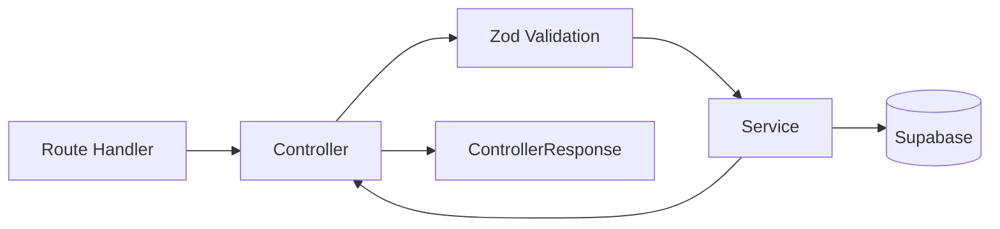

# API

## Overview

The API follows a controller/service architecture. Route handlers in Next.js delegate to controllers, which validate input and coordinate services. Services contain business logic and interact with the database.

## API Structure

All API endpoints are under `/api/v1/`:

```
src/app/(backend)/api/v1/
  auth/               # Authentication (login, register, password reset)
  flashcards/         # Flashcard CRUD
    [id]/
      copy/           # Copy a flashcard
      practice/       # Practice a single flashcard
        stats/        # Practice stats for a flashcard
    decks/            # Deck CRUD
    generate/
      frompdf/        # AI-generated flashcards from PDF (SSE)
    practice/         # Flashcard practice session
      batch/          # Submit batch practice results
      due/            # Due flashcards for review
        breakdown/    # Due breakdown by deck
        count/        # Count of due flashcards
      stats/          # Practice statistics
    stats/
      teacher/        # Teacher flashcard statistics
        difficulty/
          [bucket]/   # Per-difficulty stats
    topics/           # Flashcard topic CRUD
  health/             # Health check endpoint
  avatar/             # DiceBear avatar generation (public, no auth)
    [seed]/           # GET — returns SVG avatar based on seed string
  questions/          # Question CRUD
  quiz/               # Quiz system
    new/              # Start a new quiz
    [attemptId]/      # Get a specific quiz attempt
    attempts/         # List user's quiz attempts
  stats/              # Statistics
    student/          # Student dashboard stats
    teacher/          # Teacher dashboard stats
  subjects/           # Subject CRUD
  university/         # University management
    invitations/      # Invitation CRUD + bulk
    members/          # University members
```

## Avatar

Public endpoint for generating deterministic avatars. Uses [DiceBear](https://www.dicebear.com/) with the `lorelei` style. Same seed always produces the same avatar.

| Method | Endpoint                | Auth | Description                                   |
| ------ | ----------------------- | ---- | --------------------------------------------- |
| `GET`  | `/api/v1/avatar/[seed]` | ❌   | Generate SVG avatar (immutable cache, 1 year) |

**Response:** `image/svg+xml` with `Cache-Control: public, max-age=31536000, immutable`

The seed is typically the user's email address. The route is excluded from auth in `routes.config.ts` so `` tags can load it without cookies.

## Billing & Stripe

`APP_ENV` selects the deployment posture (`production`, `development`, `test`,
`qa`; production is the default) and `PAYMENT_DRIVER` selects the provider at
boot. Development, test and QA default to `mock`, which simulates a successful
checkout; `stripe` uses Stripe-hosted Checkout and the hosted Billing Portal.
Production always uses `stripe`: `PAYMENT_DRIVER=mock` is a boot error there,
test keys are refused, and `NEXT_PUBLIC_SITE_URL` must be an `https://`
non-localhost origin. No Stripe.js ships in the browser bundle.

Checkout creation, change-plan, cancel and reconcile are per-process, per-user
rate limited (10/min for the money actions, 20/min for reconcile); a rejected
call returns `429 RATE_LIMITED` with `Retry-After`. `CHECKOUT_KILL_SWITCH=1`
stops new Checkout Sessions (503) without touching the payment driver or
webhooks.

Every endpoint below except `POST /api/v1/stripe/webhook` in `stripe` mode is
authenticated by `withAuth()` (the proxy skips `/api/*`); the webhook is public
and verified by its signature over the raw body. The billing **owner is the
authenticated user** (`ctx.userId`) for
personal plans and the **active organization** (`ctx.activeOrgId`,
`ctx.accountType`) for organization plans — with one documented exception:
`create-checkout-session` accepts an `orgId` because a manager can buy for a
non-active organization. That id is only a hint: the server re-checks
`org_members` + the `admin` role before using it. The client never supplies a
customer id, subscription id, price id or amount.

| Method | Endpoint                                 | Body                           | Notes                                                                                                                                                          |
| ------ | ---------------------------------------- | ------------------------------ | -------------------------------------------------------------------------------------------------------------------------------------------------------------- |
| `GET`  | `/api/v1/billing/subscription`           | —                              | Shared read model: effective plan, billed plan, status, period, cancel/pending flags, portal/change/cancel capability, invoice URL                             |
| `POST` | `/api/v1/stripe/create-checkout-session` | `{ planKey, orgId?, locale? }` | Returns `{ url }`: hosted Stripe Checkout, or the local mock form. `orgId` is required for manager plans and must be a uuid                                    |
| `GET`  | `/api/v1/stripe/portal?locale=pl\|en`    | —                              | Returns `{ url }` for the hosted Billing Portal; `404` when the owner has no Stripe customer mapping                                                           |
| `POST` | `/api/v1/billing/change-plan`            | `{ planKey }`                  | Upgrade applies now (anchor reset + unused-time credit); downgrade schedules at the period boundary. No entitlement write                                      |
| `POST` | `/api/v1/billing/cancel`                 | `{ cancel: boolean }`          | `true` = cancel at period end, `false` = reactivate. No entitlement write                                                                                      |
| `POST` | `/api/v1/billing/release-scheduled-plan` | —                              | “Keep current plan”: releases a scheduled downgrade and clears the display marker. No entitlement write; returns `{ released: false }` when no schedule exists |
| `POST` | `/api/v1/billing/reconcile`              | `{ sessionId }`                | Success-page reconcile: verifies session ownership, reuses the idempotent activation path, activate-only, per-user rate-limited                                |
| `POST` | `/api/v1/stripe/webhook`                 | raw Stripe event               | `stripe` mode: public + `stripe-signature` verified over the raw body. `mock` mode: `withAuth`, caller's own account only                                      |

### Read model

```jsonc
{
  "provider": "mock | stripe",
  "planKey": "spark", // effective entitlement (/me/plan); may be a seat plan
  "planName": "StudiQ Spark",
  "billedPlanKey": "spark", // what Stripe actually bills
  "billedPlanName": "StudiQ Spark",
  "status": "active | trialing | past_due | unpaid | canceled | incomplete | incomplete_expired | paused | free | none",
  "currentPeriodEnd": "2026-12-01T00:00:00.000Z",
  "cancelAtPeriodEnd": false,
  "pendingPlanKey": null, // display-only marker for a scheduled phase or an unpaid upgrade
  "priceMonthly": 999, // minor units
  "currency": "PLN",
  "canManagePortal": true,
  "canChangePlan": true,
  "canCancel": true,
  "hostedInvoiceUrl": "https://invoice.stripe.com/…", // owner-scoped, signed
}
```

The response is `Cache-Control: private, no-store` because the invoice URL is
signed.

### Errors

| Code                   | When                                                                                                              |
| ---------------------- | ----------------------------------------------------------------------------------------------------------------- |
| `BAD_REQUEST`          | Free plan, unknown plan/cadence, missing org id, change to the current plan                                       |
| `UNAUTHORIZED`         | No session (every route except the Stripe webhook)                                                                |
| `FORBIDDEN`            | Wrong plan family, non-admin org caller, foreign checkout session                                                 |
| `NOT_FOUND`            | No active subscription/customer mapping (mock driver returns this for provider actions)                           |
| `CONFLICT`             | Owner already has an active subscription, or the live Stripe price no longer matches the mirror                   |
| `UNPROCESSABLE_ENTITY` | Invalid body (e.g. missing `planKey`, non-uuid `orgId`)                                                           |
| `RATE_LIMITED`         | Per-user burst limit exhausted on checkout / change-plan / cancel / reconcile (429, `Retry-After`)                |
| `SERVICE_UNAVAILABLE`  | Checkout kill switch, Managed Payments misconfiguration, missing/mismatched `stripe_prices`, or a provider outage |

Entitlements (`organizations.plan`, `profiles.personal_plan_key`) are written
**only** by `EntitlementService` from the webhook path. `POST /billing/reconcile`
does not write them directly either: it reuses the same idempotent activation
path, so the write still happens inside `EntitlementService`. `change-plan`,
`cancel` and `release-scheduled-plan` never write an entitlement.

## Request Flow



## Controllers

**Location:** `src/server/controllers/`

Controllers handle:

- Parsing request bodies
- Validating input with Zod schemas
- Calling appropriate service methods
- Returning standardized `ControllerResponse` objects

```typescript
class QuestionController {
  async create(body: unknown, userId: string): Promise<ControllerResponse> {
    const parsed = CreateQuestionSchema.safeParse(body);
    if (!parsed.success) {
      return {
        success: false,
        statusCode: 422,
        error: 'UNPROCESSABLE_ENTITY',
        details: parsed.error.issues,
      };
    }
    const question = await questionService.create(parsed.data, userId);
    return { success: true, statusCode: 201, data: question };
  }
}
```

## Services

**Location:** `src/server/services/`

Services handle:

- Database queries via Supabase client
- Business logic
- Error throwing via `AppError`

```typescript
class QuestionService {
  async create(data: CreateQuestionInput, userId: string) {
    const supabase = await createClient();
    const { data: question, error } = await supabase
      .from('questions')
      .insert({ ...data, created_by: userId })
      .select()
      .single();
    if (error) throw new AppError('INTERNAL_SERVER');
    return question;
  }
}
```

## Validation

Input validation uses Zod schemas defined in `src/server/models/`. Each domain has its own model file:

```typescript
// src/server/models/question.model.ts
export const CreateQuestionSchema = z.object({
  subjectId: z.string().uuid().optional(),
  type: z.enum(['mcq', 'true_false', 'open']),
  content: z.string().min(1),
  difficulty: z.enum(['easy', 'medium', 'hard']).default('medium'),
  answers: z
    .array(
      z.object({
        content: z.string().min(1),
        isCorrect: z.boolean(),
        orderIndex: z.number().int().default(0),
      }),
    )
    .min(1),
});
```

## Error Handling

Services throw `AppError` with a code. Controllers catch these and convert them to appropriate HTTP responses:

```typescript
try {
  const result = await service.doSomething();
  return { success: true, statusCode: 200, data: result };
} catch (error) {
  if (error instanceof AppError) {
    return { success: false, statusCode: error.statusCode, error: error.code };
  }
  return { success: false, statusCode: 500, error: 'INTERNAL_SERVER' };
}
```

## API Documentation

Swagger/OpenAPI documentation is available at `/api/docs` when running the development server. Route definitions use `@asteasolutions/zod-to-openapi` to generate the OpenAPI spec from Zod schemas.

## Standard Response Format

All API responses follow this structure:

```typescript
// Success
{ "success": true, "data": { ... } }

// Error
{ "success": false, "error": "ERROR_CODE", "details": [...] }
```
