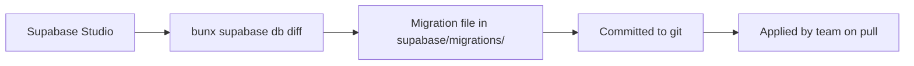

# Database

## Overview

The database is a PostgreSQL 17 instance managed by Supabase. Schema changes are versioned through SQL migration files, logical schema files are organized by domain in `supabase/schemas/`, and seed data lives in `supabase/seeds/`.

## Migration Workflow



### Creating Migrations

After modifying tables in Supabase Studio:

```bash
# Default stack; for a named stack use --remote="$DB_URL" as shown under
# Applying Migrations.
bunx supabase db diff -f migration_name
```

This generates a SQL file in `supabase/migrations/` with the schema diff.

### Applying Migrations

`bun run env:ensure --profile web` does **not** apply pending migrations when this checkout's stack is
already running (a healthy stack is reused as-is). After a `git pull` that adds
migrations:

```bash
# Apply migrations to the selected stack (default or SUPABASE_STACK)
STACK=${SUPABASE_STACK:-$(sed -n 's/^SUPABASE_STACK=\([^#[:space:]]*\).*/\1/p' .env.local 2>/dev/null | tail -n1 | tr -d "'\"")}
if [ -n "$STACK" ]; then
  DB_URL=$(bunx supabase status --stack "$STACK" --env | sed -n "s/^DB_URL='\\(.*\\)'$/\\1/p")
  # The local Postgres is plaintext, so `--remote` needs sslmode=disable (the
  # same rule as `env:reset-db`); keep the URL's existing query params.
  case "$DB_URL" in
    *sslmode=*) ;;
    *\?*) DB_URL="$DB_URL&sslmode=disable" ;;
    *) DB_URL="$DB_URL?sslmode=disable" ;;
  esac
  bunx supabase db push --remote="$DB_URL" --yes
else
  bunx supabase db push
fi
```

In CLI v3 a bare `db push` targets the local **default** stack; database commands
cannot take `--stack`. The conditional above reads `SUPABASE_STACK` from the
shell or root `.env.local`, resolves that stack's `DB_URL`, appends
`sslmode=disable` (preserving any query params the URL already carries), and
passes it as `--remote`, so it cannot silently migrate the default database.

A fresh `supabase start` (new volume) applies migrations during initialization;
use `bun run env:reset-db --yes` to drop, recreate and re-seed this branch's database.

### Resetting Database

```bash
bun run env:reset-db --yes
```

This drops and recreates **this branch's selected stack**, applying all
migrations and loading seed data. `env:reset-db` uses the named stack's DB URL
when `SUPABASE_STACK` is set, refuses in shared mode, and never touches another
checkout's stack. Plain `bunx supabase db reset` targets the branch's **default**
stack; for a named stack prefer `SUPABASE_STACK=test bun run env:reset-db --yes`, or use
the `DB_URL` extraction above with
`bunx supabase db reset --remote="$DB_URL" --yes`.

## Schema Organization

Migrations are timestamped SQL files containing incremental DDL changes. In addition, `supabase/schemas/` contains logically-organized schema files by domain:

```
supabase/
├── migrations/              # Incremental, ordered by timestamp
│   ├── 20260601064040_mig.sql
│   ├── 20260601105712_univ_id_questions.sql
│   ├── 20260603060842_flashcards_sm2.sql
│   ├── 20260608063709_spaces-to-decks-rename.sql
│   ├── 20260609065731_rbac_updated.sql
│   ├── 20260610053450_orphan_flashcards_cleanup_function.sql
│   └── z_realtime.sql
└── schemas/                 # Logical groupings (selected domains)
    ├── 00_enums.sql
    ├── 01_config.sql
    ├── 03_organizations.sql
    ├── 04_profiles.sql
    ├── 05_org_members.sql
    ├── 07_invitations.sql
    ├── 24_questions.sql
    ├── 27_question_options.sql
    ├── 30_flashcards.sql
    ├── 31_topics.sql
    ├── 34_flashcard_decks.sql
    ├── 39_quiz_attempts.sql
    ├── 42_student_answers.sql
    ├── 45_flashcard_practice.sql
    ├── 46_flashcard_review_state.sql
    ├── 55_rbac_permissions.sql
    ├── 56_org_roles.sql
    ├── 65_payments.sql
    ├── 66_billing.sql
    └── 68_activity_organization.sql
```

## Seed Data

Seed files are located in `supabase/seeds/` and are organized by domain:

| File                | Purpose                                            |
| ------------------- | -------------------------------------------------- |
| `00_plans.sql`      | Plan catalog, features, limits, default free plans |
| `01_seed.sql`       | Auth users, organizations, content and tenants     |
| `09_perms.sql`      | RBAC permissions                                   |
| `99_dev_grants.sql` | Local-only grants                                  |
| `99_realtime.sql`   | Local realtime publication                         |

## Table Domains

### Users & Profiles

| Table           | Description                                         |
| --------------- | --------------------------------------------------- |
| `profiles`      | User profiles, account type, `personal_plan_key`    |
| `organizations` | Organizations, default group and `plan` entitlement |
| `org_members`   | Membership + `org_role_id`                          |
| `org_roles`     | Role names (`admin`, `manager`, `teacher`, …)       |
| `invitations`   | Token-based invitation system                       |

### Billing & Payments

| Table                   | Description                                                                                                                                                                                                                                                                                                                                                                                                            |
| ----------------------- | ---------------------------------------------------------------------------------------------------------------------------------------------------------------------------------------------------------------------------------------------------------------------------------------------------------------------------------------------------------------------------------------------------------------------- |
| `billing_customers`     | One Stripe customer per owner and `livemode` (`user_id` XOR `organization_id`). Never exposed to clients.                                                                                                                                                                                                                                                                                                              |
| `billing_subscriptions` | Stripe subscription mirror: plan/price key, status, period, cancel/pending flags, `last_event_created` freshness fence. Own-row and org-manager reads (RLS).                                                                                                                                                                                                                                                           |
| `stripe_prices`         | Plan → Stripe Price map per `(plan_key, billing_cycle, livemode)`; validated on every checkout (amount, currency, monthly interval). No client grants.                                                                                                                                                                                                                                                                 |
| `stripe_webhook_events` | Idempotency/claim/lease table keyed by Stripe `event.id`; stores type/status/error only, never the payload. No client grants.                                                                                                                                                                                                                                                                                          |
| `payments`              | One row per purchase: a paid invoice for Stripe, one row per mock checkout. `provider` is `mock` or `stripe`; each provider has one replay-safe key (`session_id` for mock, `stripe_invoice_id` for Stripe). The Stripe columns are `stripe_customer_id`, `stripe_subscription_id`, `stripe_invoice_id` (unique), `stripe_checkout_session_id` (unique, create-invoice only), `hosted_invoice_url`, `invoice_pdf_url`. |

RLS: `payments` is own-row readable and has no client write policy;
`billing_subscriptions` is own-row readable and readable by a manager of the
subscription's organization (any organization they manage, not just the active
one). `billing_customers`, `stripe_prices` and `stripe_webhook_events` have
**no** client grants — all writes go through the service-role client
(`EntitlementService`, `payment-history.repository.ts` and the webhook
repositories). Do not add a browser-side Supabase client for billing.

### Learning System

| Table                         | Description                                  |
| ----------------------------- | -------------------------------------------- |
| `subjects`                    | Course subjects owned by users               |
| `questions`                   | Questions with type, difficulty, and content |
| `question_answers`            | Multiple choice answers for questions        |
| `flashcards`                  | Flashcard content (front/back)               |
| `flashcard_topics`            | Topic groupings for flashcards               |
| `flashcard_decks`             | User-defined flashcard collections           |
| `flashcard_topic_assignments` | Flashcard-to-topic relationships             |
| `flashcard_deck_assignments`  | Flashcard-to-deck relationships              |

### Quiz System

| Table                    | Description                              |
| ------------------------ | ---------------------------------------- |
| `quiz_attempts`          | User quiz sessions                       |
| `quiz_attempt_questions` | Questions within a quiz attempt          |
| `quiz_answers`           | User's selected answers with correctness |

### Practice Tracking

| Table                    | Description                                          |
| ------------------------ | ---------------------------------------------------- |
| `flashcard_practice`     | Flashcard practice history with correctness tracking |
| `flashcard_review_state` | SM-2 spaced repetition state per flashcard           |

### RBAC (Role-Based Access Control)

| Table              | Description                                                        |
| ------------------ | ------------------------------------------------------------------ |
| `permissions`      | Static list of permission names (e.g. `flashcard.read`)            |
| `role_permissions` | Maps roles to permissions with scopes (`own`, `university`, `any`) |

## Database Access

The application accesses the database through the Supabase client:

- **Server API routes/services:** `@studiq/server/lib/supabase/server` — SSR cookies and the caller's JWT, so RLS applies
- **Service role:** `@studiq/server/lib/supabase/service` — webhook, entitlement and bootstrap writes only
- **Browser:** the frontend talks to the REST API through `apps/web/src/lib/api.ts`; there is no browser-side Supabase client
- **Tests:** `createRealClient()` — anon key for direct RLS checks
