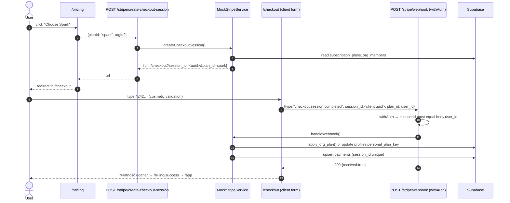
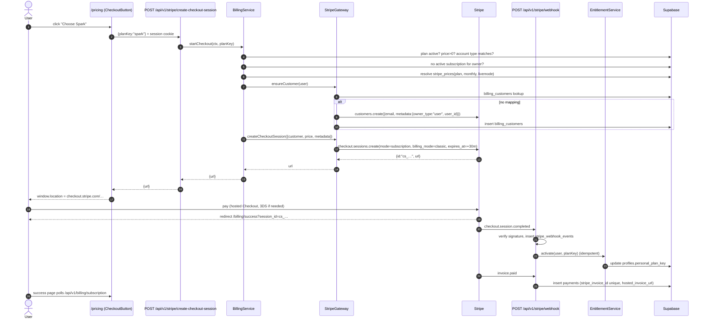
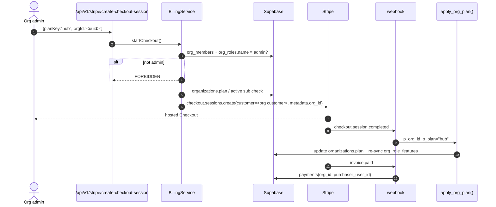
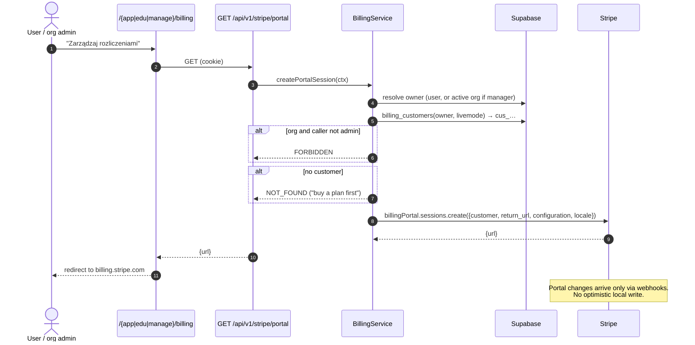
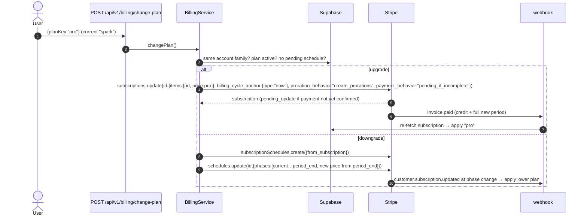
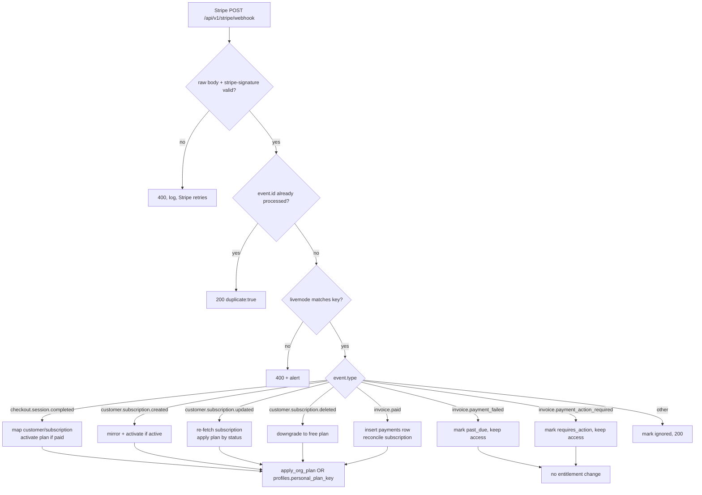

# Real Stripe integration behind the payment interface (#662)

**Date:** 2026-10-30
**Status:** Design — approved decisions. Phase 1 (gateway seam + `PAYMENT_DRIVER` boot validation), phase 2A (Stripe customer + hosted Checkout + `BillingService` validation) and phase 3 (signed webhook + idempotent entitlement sync) are implemented behind `PAYMENT_DRIVER=stripe`, with the mock still the default. The success-page reconcile endpoint, the portal, plan changes and the billing UI remain phase 4.
**Issue:** [#662](https://github.com/logyQT/studiq/issues/662) (ROADMAP Phase 6)
**Scope owner:** SoCoCold (Alan) per the issue body; the issue currently has no GitHub assignee

---

## 1. Goals, non-goals and decisions

### Goals

1. Replace the simulated checkout with **real Stripe subscriptions in test mode**, without changing the entitlement model (`profiles.personal_plan_key`, `organizations.plan`, `apply_org_plan`).
2. Extract a **`PaymentGateway` interface** so `mock` and `stripe` are two adapters behind the same domain flow.
3. Verify every webhook with the **raw body + `stripe-signature`**, deduplicate on `event.id`, and survive out-of-order delivery.
4. Keep a **customer ↔ owner mapping** (user or organization) and a local subscription mirror so the app can render billing state without trusting the client.
5. Preserve `payments` as the purchase log and add invoice-level rows with hosted invoice links.
6. Keep the mock path **byte-for-byte behaviourally identical** and the default everywhere until an operator opts in.

### Non-goals (MVP)

- One-time payments / `mode: 'payment'`.
- Yearly billing (`price_yearly` stays unused; lookup keys reserve the `_monthly` slot).
- Trials, coupons/promotion codes, automatic tax/VAT, credit notes.
- Per-seat Stripe quantity (seats remain plan allocations).
- Org-wide invoice history UI, refunds/disputes automation, dunning emails.
- An in-app webhook replay tool.
- Migrating existing mock purchases into Stripe subscriptions.

### Decisions (operator answers, 2026-10-30)

| #   | Decision             | Choice                                                                                                                                                     |
| --- | -------------------- | ---------------------------------------------------------------------------------------------------------------------------------------------------------- |
| D1  | Billing cadence      | **Monthly only.** Lookup key encodes `_monthly`; yearly can be added later.                                                                                |
| D2  | Currency             | **PLN only**, matching the catalog (`999` = 9.99 PLN). Assert plan currency == price currency.                                                             |
| D3  | Org customer         | **The organization owns the Stripe Customer** (`metadata.org_id`). **Any current org admin** may open the Billing Portal.                                  |
| D4  | Seat quantity        | **Quantity 1 per org plan.** Do not derive quantity from member count.                                                                                     |
| D5  | Plan changes         | First purchase = Checkout. **Upgrades in-app**: reset the billing cycle, credit unused time, charge the full new period now. **Downgrades at period end.** |
| D6  | Cancel               | **At period end**; the user may **reactivate** before it takes effect. Immediate cancel only as an admin/ops action.                                       |
| D7  | Payment types        | **Subscriptions only.**                                                                                                                                    |
| D8  | Extras               | **No trials, no coupons, no automatic tax.** Portal may collect a tax ID; invoices are Stripe-hosted.                                                      |
| D9  | Portal actions       | **Payment method, invoice history, cancel at period end, tax ID, customer email/address.** No `subscription_update`.                                       |
| D10 | Products & prices    | **Idempotent bootstrap script + DB price map** (`stripe_prices`); no price IDs in env or git.                                                              |
| D11 | Entitlement source   | **Combination, one job each:** `checkout.session.completed` activates, `customer.subscription.*` owns lifecycle, `invoice.paid` writes history.            |
| D12 | Payment history      | **One row per paid invoice** + `hosted_invoice_url` link. Mock keeps one row per checkout.                                                                 |
| D13 | Mock/CI default      | **Mock is the default** in dev, CI, QA and preview. Stripe test-mode calls are opt-in (`RUN_STRIPE_TESTS=1`).                                              |
| D14 | Failed payment grace | **Status-driven:** keep access while `past_due`, revoke on `unpaid` / `canceled` / `incomplete_expired` / `subscription.deleted`. No local timer.          |
| D15 | Webhook tooling      | **Stripe Dashboard/CLI replay only**; idempotency table makes replay safe.                                                                                 |

### Design decisions made here (not operator policy)

| #   | Decision                                                 | Rationale                                                                                                                                                                                                                                                                                                                                   |
| --- | -------------------------------------------------------- | ------------------------------------------------------------------------------------------------------------------------------------------------------------------------------------------------------------------------------------------------------------------------------------------------------------------------------------------- |
| X1  | **Create subscriptions in `billing_mode: classic`**      | Flexible mode is the API default since `2025-09-30.clover` and **never resets the billing cycle anchor**. D5 requires a real anchor reset, which only works in classic mode. Set it explicitly at Checkout (`subscription_data.billing_mode.type = 'classic'`). Flexible → classic migration is impossible, but classic is fully supported. |
| X2  | **Read period dates from `subscription.items.data[]`**   | Top-level `current_period_start/end` were removed by `2025-03-31.basil`.                                                                                                                                                                                                                                                                    |
| X3  | **Node runtime for the webhook route**                   | `stripe.webhooks.constructEvent` is synchronous on Node; `constructEventAsync` is only needed on Edge/Workers. Pin `export const runtime = 'nodejs'`.                                                                                                                                                                                       |
| X4  | **Pin the API version in code**                          | `apiVersion: '2026-10-28.endive'` (verified current on 2026-10-30). Never let the SDK default change silently. Record `event.api_version` and warn on mismatch.                                                                                                                                                                             |
| X5  | **Plan switching is an app endpoint, not portal**        | The portal cannot reset the billing cycle. `POST /api/v1/billing/change-plan` calls `subscriptions.update` directly.                                                                                                                                                                                                                        |
| X6  | **Success page reconciles, webhook stays authoritative** | A user can land on `success_url` before the webhook. `POST /api/v1/billing/reconcile` verifies the session belongs to the caller and runs the same idempotent activation path.                                                                                                                                                              |

### Assumptions (flagged, not blocking)

- The Stripe account country is **Poland** (or another country that can present PLN). If the sandbox cannot present PLN, the fallback is EUR and requires a catalog re-denomination — blocked on operator confirmation.
- Locale mapping is `pl → 'pl'`, everything else → `'en'`.
- Plan keys are stable and are the public plan identifier (the current `planId` field is already a plan **key**).
- `payments.user_id` stays `NOT NULL`; org invoices are attributed to the **purchaser** recorded on the subscription (see §4.4).

---

## 2. Current flow vs target flow

### 2.1 Current (mock) flow



Facts that matter for the design:

- The **browser is the webhook caller** and generates the idempotency key (`crypto.randomUUID()`).
- `planId` is a plan **key** (`spark`, `campus`), not a UUID.
- `/checkout` reads `plan_id` and `org_id` from the URL and decides `isOrgPlan` from `for_account_type === 'manager'`.
- `createPortalSession` ignores the user and returns `/app/billing`; **no UI calls it**.
- `/manage/billing` is a `mailto:`; `/edu/billing` is fully hardcoded (`$29.99`, 50 seats).
- `payments.session_id` is `NOT NULL UNIQUE`; the row is written by the same webhook that changes the plan.

### 2.2 Target: personal monthly checkout



### 2.3 Target: organization checkout

Differences from 2.2 only:

1. `BillingService` resolves `orgId` from the request, re-checks `isOrgAdminRole` on `org_members.org_roles.name`.
2. `ensureCustomer` uses `owner_type='org'`, `org_id`, `billing_customers.organization_id`.
3. Checkout metadata carries `owner_type:'org'`, `org_id`, `purchaser_user_id`.
4. `EntitlementService.activate` calls `apply_org_plan(org_id, plan_key)` with the **service-role** client.
5. The buyer's `profiles.personal_plan_key` is **never** touched (ADR-0007 / #228).
6. `payments` row: `organization_id = org_id`, `user_id = purchaser_user_id` (the buyer).



### 2.4 Target: Billing Portal



### 2.5 Target: upgrade, downgrade, cancel, reactivate



Cancel/reactivate use the same subscription:

```text
POST /api/v1/billing/cancel {cancel:true}  → subscriptions.update(id,{cancel_at_period_end:true})
POST /api/v1/billing/cancel {cancel:false} → subscriptions.update(id,{cancel_at_period_end:false})
```

The plan is **not** changed when cancel is scheduled. It is downgraded only on `customer.subscription.deleted` (period end) or an immediate ops cancel.

SDK note: `billing_cycle_anchor` on `subscriptions.update` is `{ type: 'now' }` in `stripe-node` v23 (the docs' curl example encodes the same value as `billing_cycle_anchor=now`; the typed SDK requires the object form). `proration_behavior: 'create_prorations'` is what produces the unused-time credit; with a classic-mode anchor reset Stripe issues the invoice immediately.

### 2.6 Webhook → entitlement (single responsibility per event)



---

## 3. Interface design

### 3.1 The seam we have today

`MockStripeService` mixes three things:

1. **Provider I/O** — build a fake URL, return a fake portal URL.
2. **Domain authorization** — plan purchasable, org admin.
3. **Entitlement writes** — `apply_org_plan`, `profiles.personal_plan_key`, `payments`.

A second provider cannot be inserted without splitting these. The webhook is also misleading: the real Stripe webhook is unauthenticated and signature-verified, while the mock webhook is authenticated and acts on `ctx.userId`.

### 3.2 Target module layout

```text
packages/server/src/lib/payment/
  payment-gateway.ts          # types + PaymentGateway + WebhookEnvelope
  payment-gateway.factory.ts  # createPaymentGatewayFromEnv + getPaymentGateway + PaymentConfigError
  mock-payment.gateway.ts     # adapter over the existing mock behaviour
  stripe-payment.gateway.ts   # Stripe SDK calls, signature verification, event normalization
  stripe-client.ts            # narrow interface + real implementation (test injection point)

packages/server/src/services/
  billing.service.ts          # domain: plan/org/admin/owner/customer/checkout/portal/change/cancel
  entitlement.service.ts      # the only writer of plan entitlements
  stripe-webhook.service.ts   # idempotency + event dispatch + reconcile
  mock-stripe.service.ts      # kept as the mock adapter's internals (shrunk)
```

> No `lib/payment/index.ts` — the repo bans barrel files. Import the concrete module.

### 3.3 `PaymentGateway`

The interface only contains provider operations. Domain rules stay in `BillingService`, so both adapters get the same authorization.

```ts
// packages/server/src/lib/payment/payment-gateway.ts
import type { ServiceResult } from '@studiq/server/lib/service-result';

export type PaymentDriver = 'mock' | 'stripe';
export type BillingCycle = 'monthly';

export type PaymentOwner =
  | { type: 'user'; userId: string; accountType: AccountType }
  | { type: 'org'; orgId: string; userId: string; accountType: AccountType };

export interface CheckoutCommand {
  owner: PaymentOwner;
  planKey: string;
  planName: string;
  amount: number; // minor units, from the catalog
  currency: string;
  billingCycle: BillingCycle;
  priceId: string; // resolved by BillingService from stripe_prices
  locale: 'pl' | 'en';
  idempotencyKey: string;
}

export interface CheckoutResult {
  url: string;
  /** Provider session id; mock returns its own uuid, Stripe returns cs_… */
  sessionId: string;
}

export interface PortalCommand {
  owner: PaymentOwner;
  customerId: string;
  returnUrl: string;
  locale: 'pl' | 'en';
}

export interface ChangePlanCommand {
  owner: PaymentOwner;
  customerId: string;
  subscriptionId: string;
  currentPlanKey: string;
  targetPlanKey: string;
  targetPriceId: string;
  direction: 'upgrade' | 'downgrade';
  idempotencyKey: string;
}

export interface CancelCommand {
  owner: PaymentOwner;
  subscriptionId: string;
  cancel: boolean;
}

export interface PaymentGateway {
  readonly driver: PaymentDriver;
  createCheckoutSession(cmd: CheckoutCommand): Promise<ServiceResult<CheckoutResult>>;
  createPortalSession(cmd: PortalCommand): Promise<ServiceResult<{ url: string }>>;
  changePlan(cmd: ChangePlanCommand): Promise<ServiceResult<{ status: 'applied' | 'scheduled' }>>;
  cancelAtPeriodEnd(cmd: CancelCommand): Promise<ServiceResult<void>>;
  handleWebhook(envelope: WebhookEnvelope): Promise<ServiceResult<WebhookOutcome>>;
}

/**
 * The two webhook contracts are deliberately different shapes, so nobody can
 * accidentally call the mock path with an unauthenticated request (or vice
 * versa).
 */
export type WebhookEnvelope =
  | { kind: 'mock'; ctx: RequestContext; body: unknown }
  | { kind: 'stripe'; rawBody: string; signature: string | null };

export type WebhookOutcome = { received: true; duplicate?: boolean; ignored?: boolean };
```

`MockPaymentGateway` delegates to the existing `MockStripeService` and returns the same `/checkout?session_id=…` URL, so mock behaviour is unchanged. `StripePaymentGateway` wraps a `StripeClient` interface:

```ts
// packages/server/src/lib/payment/stripe-client.ts
export interface StripeClient {
  customers: {
    create(
      params: Stripe.CustomerCreateParams,
      opts?: { idempotencyKey?: string },
    ): Promise<Stripe.Customer>;
  };
  checkout: {
    sessions: {
      create(
        params: Stripe.Checkout.SessionCreateParams,
        opts?: { idempotencyKey?: string },
      ): Promise<Stripe.Checkout.Session>;
      retrieve(
        id: string,
        params?: Stripe.Checkout.SessionRetrieveParams,
      ): Promise<Stripe.Checkout.Session>;
    };
  };
  billingPortal: {
    sessions: {
      create(
        params: Stripe.BillingPortal.SessionCreateParams,
      ): Promise<Stripe.BillingPortal.Session>;
    };
  };
  subscriptions: {
    retrieve(id: string): Promise<Stripe.Subscription>;
    update(
      id: string,
      params: Stripe.SubscriptionUpdateParams,
      opts?: { idempotencyKey?: string },
    ): Promise<Stripe.Subscription>;
  };
  subscriptionSchedules: {
    create(params: Stripe.SubscriptionScheduleCreateParams): Promise<Stripe.SubscriptionSchedule>;
    update(
      id: string,
      params: Stripe.SubscriptionScheduleUpdateParams,
    ): Promise<Stripe.SubscriptionSchedule>;
    release(id: string): Promise<Stripe.SubscriptionSchedule>;
  };
  webhooks: {
    constructEvent(payload: string, header: string, secret: string): Stripe.Event;
  };
  prices: { retrieve(id: string): Promise<Stripe.Price> };
}
```

`stripeClient` is constructed once per process with the pinned API version; tests inject a fake object, no network.

**Phase 1 implementation note.** The shipped seam (`packages/server/src/lib/payment/payment-gateway.ts`) uses the caller-shaped inputs `userId`, `accountType`, `planKey`, `orgId?`, `locale?`, `idempotencyKey` — exactly the fields `MockStripeService` already takes — so routing the controller through the gateway is behaviour-preserving. `MockPaymentGateway` delegates to the existing service; `changePlan`/`cancelAtPeriodEnd` return `NOT_FOUND` because the simulation has no subscription. `BillingService`, the resolved `PaymentOwner`, and `priceId`/`customerId` fields arrive with the Stripe adapter in Phase 2; the shapes above remain the target contract.

### 3.4 Route-level webhook contract (explicit branching)

`apps/web/src/app/(backend)/api/v1/stripe/webhook/route.ts`:

```ts
export const runtime = 'nodejs';

export async function POST(req: NextRequest) {
  const gateway = getPaymentGateway();

  if (gateway.driver === 'mock') {
    // Authenticated: the checkout page calls this endpoint as the user.
    return withAuth(req, async (ctx) =>
      toNextResponse(await stripeController.handleMockWebhook(ctx, await req.json())),
    );
  }

  // Public: Stripe cannot send a Supabase session. Verified by signature.
  return withPublicTracing(req, async () =>
    toNextResponse(await stripeController.handleStripeWebhook(req)),
  );
}
```

- `handleMockWebhook` keeps the current `body.user_id === ctx.userId` guard.
- `handleStripeWebhook` calls `stripeWebhookService.handle(req.text(), req.headers.get('stripe-signature'))`; it never calls `withAuth`, never parses JSON before verification, and never reads a body `user_id`.
- `withPublicTracing` keeps the root span, `x-trace-id`, metrics and 4xx/5xx logging.

### 3.5 Driver selection and boot validation

Mirror `packages/server/src/lib/mailer/index.ts` exactly.

```ts
// payment-gateway.factory.ts
export class PaymentConfigError extends Error { … }

export function createPaymentGatewayFromEnv(env = process.env): PaymentGateway {
  const driver = (env.PAYMENT_DRIVER ?? 'mock').trim().toLowerCase();

  if (driver === '' || driver === 'mock') return new MockPaymentGateway(…);

  if (driver !== 'stripe') {
    throw new PaymentConfigError(`unknown PAYMENT_DRIVER "${driver}" (expected mock or stripe)`);
  }

  const key = required(env, 'STRIPE_SECRET_KEY');
  if (!/^sk_(test|live)_/.test(key)) throw new PaymentConfigError('STRIPE_SECRET_KEY must start with sk_test_ or sk_live_');
  if (key.startsWith('sk_live_') && env.NODE_ENV !== 'production' && env.STRIPE_ALLOW_LIVE !== '1') {
    throw new PaymentConfigError('live Stripe key refused outside production');
  }

  const webhookSecret = required(env, 'STRIPE_WEBHOOK_SECRET');
  if (!webhookSecret.startsWith('whsec_')) throw new PaymentConfigError(…);

  const portalConfig = required(env, 'STRIPE_PORTAL_CONFIGURATION_ID');
  if (!portalConfig.startsWith('bpc_')) throw new PaymentConfigError(…);

  return new StripePaymentGateway({ key, webhookSecret, portalConfig, livemode: key.startsWith('sk_live_') });
}

let cached: PaymentGateway | undefined;
export function getPaymentGateway(): PaymentGateway {
  if (!cached) cached = createPaymentGatewayFromEnv();
  return cached;
}
```

`apps/web/src/instrumentation.ts` calls `getPaymentGateway()` in the `NEXT_RUNTIME === 'nodejs'` block, **before** the OTel opt-out, exactly like `getMailer()`:

```ts
const { getPaymentGateway } = await import('@studiq/server/lib/payment/payment-gateway.factory');
getPaymentGateway(); // throws PaymentConfigError at boot on bad config
```

Result: a typo or a missing secret crashes the server at start-up, not at the first checkout. The `mock` driver requires **no** Stripe env at all.

The factory imports the Stripe SDK **only through `stripe-payment.gateway.ts`** (a `@studiq/server` module that only server routes import); no client component imports it, the webhook route pins the Node runtime, and there is no `NEXT_PUBLIC_` Stripe key. Do not try to lazy-load it: the boot-time singleton is synchronous, and a server-only static import is simpler and cannot reach the browser bundle.

`livemode` is derived from the key prefix, never from an env flag that could disagree with the key.

---

## 4. Data model

### 4.1 Reuse vs add

| Data                      | Reuse                                            | Add                                                                 |
| ------------------------- | ------------------------------------------------ | ------------------------------------------------------------------- |
| Plan catalog + prices     | `subscription_plans` (amount/currency/is_active) | `stripe_prices` mapping (price id ↔ plan/cycle/livemode)            |
| Personal entitlement      | `profiles.personal_plan_key`                     | —                                                                   |
| Org entitlement           | `organizations.plan` + `apply_org_plan`          | —                                                                   |
| Purchase log              | `payments`                                       | `provider`, Stripe ids, `hosted_invoice_url`, nullable `session_id` |
| Customer mapping          | —                                                | `billing_customers`                                                 |
| Subscription state mirror | —                                                | `billing_subscriptions`                                             |
| Webhook idempotency       | —                                                | `stripe_webhook_events`                                             |

Why a **mapping table** instead of `stripe_customer_id` columns on `profiles`/`organizations`:

- one owner can need a **test** and a **live** customer id (`livemode` dimension);
- `profiles` writes are revoked for `authenticated` (migration `20261022000001`), and the table is service-role only anyway;
- the owner is polymorphic (user **or** organization); a `billing_customers` table encodes the XOR once and keeps `profiles` clean;
- a unique constraint on `(owner, livemode)` prevents double customers from a checkout double-click.

### 4.2 New tables

Migration `supabase/migrations/20261030120000_billing_customers_and_subscriptions.sql`:

```sql
CREATE TABLE public.billing_customers (
  id                  uuid PRIMARY KEY DEFAULT gen_random_uuid(),
  user_id             uuid REFERENCES public.profiles(id) ON DELETE CASCADE,
  organization_id     uuid REFERENCES public.organizations(id) ON DELETE CASCADE,
  stripe_customer_id  text NOT NULL UNIQUE,
  livemode            boolean NOT NULL,
  created_at          timestamptz NOT NULL DEFAULT now(),
  CONSTRAINT billing_customers_one_owner
    CHECK ((user_id IS NULL) <> (organization_id IS NULL))
);

CREATE UNIQUE INDEX billing_customers_user_livemode_key
  ON public.billing_customers (user_id, livemode) WHERE user_id IS NOT NULL;
CREATE UNIQUE INDEX billing_customers_org_livemode_key
  ON public.billing_customers (organization_id, livemode) WHERE organization_id IS NOT NULL;

CREATE TABLE public.billing_subscriptions (
  id                      uuid PRIMARY KEY DEFAULT gen_random_uuid(),
  stripe_subscription_id  text NOT NULL UNIQUE,
  stripe_customer_id      text NOT NULL REFERENCES public.billing_customers(stripe_customer_id) ON DELETE CASCADE,
  user_id                 uuid REFERENCES public.profiles(id) ON DELETE CASCADE,
  organization_id         uuid REFERENCES public.organizations(id) ON DELETE CASCADE,
  purchaser_user_id       uuid REFERENCES public.profiles(id) ON DELETE SET NULL,
  checkout_session_id     text,
  plan_key                text NOT NULL,
  price_id                text NOT NULL,
  billing_cycle           text NOT NULL DEFAULT 'monthly' CHECK (billing_cycle IN ('monthly', 'yearly')),
  status                  text NOT NULL CHECK (status IN (
                            'active','trialing','past_due','unpaid','canceled',
                            'incomplete','incomplete_expired','paused')),
  current_period_start    timestamptz,
  current_period_end      timestamptz,
  cancel_at_period_end    boolean NOT NULL DEFAULT false,
  cancel_at               timestamptz,
  canceled_at             timestamptz,
  pending_plan_key        text,
  last_event_created      bigint NOT NULL DEFAULT 0,
  livemode                boolean NOT NULL,
  created_at              timestamptz NOT NULL DEFAULT now(),
  updated_at              timestamptz NOT NULL DEFAULT now(),
  CONSTRAINT billing_subscriptions_one_owner
    CHECK ((user_id IS NULL) <> (organization_id IS NULL))
);

-- One live subscription per owner and mode. 'canceled' rows stay as history.
CREATE UNIQUE INDEX billing_subscriptions_one_active_org
  ON public.billing_subscriptions (organization_id, livemode)
  WHERE organization_id IS NOT NULL AND status IN ('active','trialing','past_due');
CREATE UNIQUE INDEX billing_subscriptions_one_active_user
  ON public.billing_subscriptions (user_id, livemode)
  WHERE user_id IS NOT NULL AND status IN ('active','trialing','past_due');

CREATE INDEX billing_subscriptions_owner_idx
  ON public.billing_subscriptions (organization_id, user_id);
```

Migration `supabase/migrations/20261030120100_stripe_prices_and_webhook_events.sql`:

```sql
CREATE TABLE public.stripe_prices (
  plan_key         text NOT NULL,
  billing_cycle    text NOT NULL CHECK (billing_cycle IN ('monthly', 'yearly')),
  stripe_price_id  text NOT NULL UNIQUE,
  currency         text NOT NULL,
  unit_amount      int NOT NULL CHECK (unit_amount >= 0),
  interval         text NOT NULL,
  livemode         boolean NOT NULL,
  active           boolean NOT NULL DEFAULT true,
  synced_at        timestamptz NOT NULL DEFAULT now(),
  PRIMARY KEY (plan_key, billing_cycle, livemode)
);

CREATE TABLE public.stripe_webhook_events (
  id              text PRIMARY KEY,              -- evt_…
  type            text NOT NULL,
  api_version     text,
  livemode        boolean NOT NULL,
  event_created   bigint NOT NULL,
  status          text NOT NULL DEFAULT 'processing'
                    CHECK (status IN ('processing','processed','ignored','failed')),
  error           text,
  received_at     timestamptz NOT NULL DEFAULT now(),
  processed_at    timestamptz
);

CREATE INDEX stripe_webhook_events_received_idx
  ON public.stripe_webhook_events (received_at DESC);
```

Migration `supabase/migrations/20261030120200_payments_stripe_columns.sql`:

```sql
ALTER TABLE public.payments ALTER COLUMN session_id DROP NOT NULL;

ALTER TABLE public.payments
  ADD COLUMN provider text NOT NULL DEFAULT 'mock'
    CHECK (provider IN ('mock', 'stripe')),
  ADD COLUMN stripe_customer_id text,
  ADD COLUMN stripe_subscription_id text,
  ADD COLUMN stripe_invoice_id text,
  ADD COLUMN stripe_checkout_session_id text,
  ADD COLUMN hosted_invoice_url text,
  ADD COLUMN invoice_pdf_url text,
  ADD COLUMN status text NOT NULL DEFAULT 'paid'
    CHECK (status IN ('paid', 'refunded', 'partially_refunded'));

CREATE UNIQUE INDEX payments_stripe_invoice_id_key
  ON public.payments (stripe_invoice_id) WHERE stripe_invoice_id IS NOT NULL;
CREATE UNIQUE INDEX payments_stripe_checkout_session_id_key
  ON public.payments (stripe_checkout_session_id) WHERE stripe_checkout_session_id IS NOT NULL;

ALTER TABLE public.payments
  ADD CONSTRAINT payments_has_external_ref
  CHECK (
    session_id IS NOT NULL
    OR stripe_invoice_id IS NOT NULL
    OR stripe_checkout_session_id IS NOT NULL
  );

CREATE INDEX idx_payments_org_paid_at
  ON public.payments (organization_id, paid_at DESC) WHERE organization_id IS NOT NULL;
```

RLS and grants:

- `billing_customers`, `stripe_prices`, `stripe_webhook_events`: `ENABLE ROW LEVEL SECURITY`, **no policies**, `REVOKE ALL FROM anon, authenticated`, `GRANT ALL TO service_role`. Customer ids must never reach a client.
- `billing_subscriptions`: own-row `SELECT` + org-admin `SELECT` (the UI needs status/cancel state), no writes from `authenticated`, `service_role` full. The org-admin policy mirrors `isOrgAdminRole`:

```sql
CREATE POLICY "Own or org-admin subscription read" ON public.billing_subscriptions
  FOR SELECT TO authenticated
  USING (
    user_id = auth.uid()
    OR (
      organization_id IS NOT NULL
      AND EXISTS (
        SELECT 1
        FROM public.org_members m
        JOIN public.org_roles r ON r.id = m.org_role_id
        WHERE m.organization_id = billing_subscriptions.organization_id
          AND m.user_id = auth.uid()
          AND r.name = 'admin'
      )
    )
  );
```

- Keep `payments` own-row read. Add **no** org read policy in MVP (org history is out of scope). Do not grant `billing_subscriptions` writes.

Also update the mirror files `supabase/schemas/65_payments.sql` (it currently omits RLS/grants that the migration has — fix that divergence) and add `supabase/schemas/66_billing.sql`. `supabase/config.toml` has `schema_paths = []`, so these are documentation mirrors; migrations remain the executable path.

### 4.3 `livemode` rules

- Every mapping row stores `livemode`; reads always filter `livemode = gateway.livemode`.
- A webhook whose `event.livemode` differs from the gateway mode is rejected with 400 and an alert log.
- The same owner may have a test customer **and** a live customer. They never collide because of the partial unique indexes.
- The bootstrap script refuses a live key unless `--live` is passed explicitly.

### 4.4 `payments` rows

Written **only** by `invoice.paid` in Stripe mode:

| Column                       | Value                                                                 |
| ---------------------------- | --------------------------------------------------------------------- |
| `user_id`                    | `billing_subscriptions.purchaser_user_id` (org buyer stays the payer) |
| `organization_id`            | org id for org plans, else `null`                                     |
| `plan_key` / `plan_name`     | resolved plan (snapshot)                                              |
| `amount`                     | `invoice.amount_paid` (minor units, after credit/discount/tax)        |
| `currency`                   | `invoice.currency.toUpperCase()`                                      |
| `session_id`                 | `null` for Stripe                                                     |
| `stripe_invoice_id`          | `invoice.id` (unique → replay-safe)                                   |
| `stripe_checkout_session_id` | from `billing_subscriptions.checkout_session_id` when known           |
| `stripe_customer_id`         | `invoice.customer`                                                    |
| `stripe_subscription_id`     | `invoice.subscription`                                                |
| `hosted_invoice_url`         | `invoice.hosted_invoice_url`                                          |
| `invoice_pdf_url`            | `invoice.invoice_pdf`                                                 |
| `status`                     | `paid` (refunds later)                                                |
| `paid_at`                    | `invoice.status_transitions.paid_at ?? now()`                         |

Mock rows keep `provider='mock'`, `session_id` set, `amount = subscription_plans.price_monthly`, and no Stripe ids.

`purchaser_user_id` is nullable because a profile can be purged while the organization subscription keeps billing. When the recorded purchaser no longer exists, `invoice.paid` attributes the row to the **oldest current org admin**; if the org has no admin left, it logs `billing.payments_no_attributable_user` and skips the history row (the entitlement write still happens). This is the one place where the `payments.user_id NOT NULL` legacy shape forces a fallback.

Why `amount_paid` rather than the catalog price: the upgrade invoice for D5 is `full new period − unused-time credit`; the catalog price alone would misreport the charge. `plan_name`/`currency` remain snapshots, matching the existing "catalog edits must not rewrite history" rule.

### 4.5 Migration order and backfill

1. `20261030120000_billing_customers_and_subscriptions.sql`
2. `20261030120100_stripe_prices_and_webhook_events.sql`
3. `20261030120200_payments_stripe_columns.sql`

Backfill:

```sql
UPDATE public.payments SET provider = 'mock' WHERE provider IS NULL; -- default already does it
```

- Existing mock rows: `provider='mock'`, `session_id` intact, no Stripe ids. `payments_has_external_ref` is satisfied by `session_id`.
- Existing entitlements (`profiles.personal_plan_key`, `organizations.plan`) are **not** touched. A user who "bought" under the mock keeps their plan; they have no `billing_customers` row, so the portal returns "no billing account" until they buy through Stripe.
- No table is dropped. `user_subscriptions` is already gone and is **not** resurrected.

---

## 5. Checkout

### 5.1 Request/response

`POST /api/v1/stripe/create-checkout-session` (auth):

```json
{ "planKey": "spark", "orgId": "uuid-or-absent" }
```

Response: `{ "url": "https://checkout.stripe.com/c/pay/cs_…" }` (mock: `/checkout?session_id=…&plan_id=spark`).

The old field name `planId` is renamed to `planKey` (it was always a key). Update `CheckoutButton`, the controller model and unit tests; no compatibility shim.

### 5.2 Server-side validation (never trust the client)

`BillingService.startCheckout(ctx, planKey, orgId?)`:

1. Load `subscription_plans` by `key`; require `is_active`, `price_monthly > 0`, and `for_account_type` null-or-equal to `ctx.accountType`. Free plans are not purchasable (`BAD_REQUEST`), wrong family is `FORBIDDEN`.
2. `isOrgPlan = plan.for_account_type === 'manager'`.
3. If org plan: require `orgId`; verify an `org_members` row for `(orgId, ctx.userId)` whose `org_roles.name` passes `isOrgAdminRole`. Reject with `FORBIDDEN` otherwise. Keep the same check as `MockStripeService.assertOrgAdmin`.
4. Reject if the owner already has a `billing_subscriptions` row with status `active|trialing|past_due` for the current `livemode` → `CONFLICT`. The UI shows "manage your subscription" instead of a second checkout.
5. Resolve `stripe_prices` for `(planKey, 'monthly', livemode, active)`; require `currency = plan.currency`, `unit_amount = plan.price_monthly`, `interval = 'month'`. A mismatch is a configuration error → `SERVICE_UNAVAILABLE` + error log (fail closed; never charge a different amount).
6. Resolve or create the customer (§5.3).
7. Call the gateway.

The client never sends an amount, currency, price id, customer id or subscription id.

### 5.3 Customer create/reuse

```ts
const existing = await repo.findCustomer(owner, livemode);
if (existing) return existing;

const customer = await stripe.customers.create({
  email: user.email,
  name: owner.type === 'org' ? org.name : profile.full_name,
  metadata: {
    studiq_owner_type: owner.type,
    studiq_user_id: owner.userId, // purchaser for orgs
    studiq_org_id: owner.type === 'org' ? owner.orgId : '',
  },
});
await repo.insertCustomer(...); // unique index resolves races; on conflict re-select
```

No persistent idempotency key on `customers.create`: Stripe replays a key for at least 24 h **even if the customer it created was deleted**, which would poison a re-checkout after a stale mapping is removed (§6.8). The DB unique index plus the conflict re-select covers concurrent creates; the losing request may leave an orphan Stripe customer, which is preferable to a deleted-customer replay.

### 5.4 Checkout Session parameters

```ts
await stripe.checkout.sessions.create(
  {
    mode: 'subscription',
    customer: customerId,
    line_items: [{ price: priceId, quantity: 1 }],
    client_reference_id: ownerId, // user id or org id
    metadata: {
      studiq_owner_type: 'user' | 'org',
      studiq_user_id: ownerUserId, // purchaser
      studiq_org_id: orgId ?? '',
      studiq_plan_key: planKey,
      studiq_billing_cycle: 'monthly',
      studiq_livemode: String(livemode),
    },
    subscription_data: {
      metadata: {/* the same five fields */},
      billing_mode: { type: 'classic' }, // X1 — required for the upgrade anchor reset
    },
    success_url: `${siteUrl}/billing/success?session_id={CHECKOUT_SESSION_ID}`,
    cancel_url: `${siteUrl}/checkout?plan_id=${planKey}&canceled=1`,
    locale: locale === 'pl' ? 'pl' : 'en',
    expires_at: checkoutExpiresAt(Date.now()), // bucket-derived; ≥30 min, ≤24 h
    allow_promotion_codes: false, // D8
    automatic_tax: { enabled: false }, // D8
    tax_id_collection: { enabled: false },
  },
  { idempotencyKey: `checkout:${owner.type}:${ownerId}:${planKey}:${bucket30min}` },
);
```

Notes:

- `client_reference_id` is capped at 200 chars; a UUID fits.
- `metadata` is duplicated on the **Session** and the **Subscription**; the subscription copy survives after the session expires and is the fallback when a price is unknown.
- `expires_at` is a pure function of the same 30-minute idempotency bucket (plus a 60 s margin), so every retry sends identical parameters and Stripe does not reject the reused key. The value is always comfortably above the 30-minute minimum and below the 24-hour maximum.
- No `payment_method_types` allow-list: use Stripe's dynamic payment methods so SCA/3DS and local methods work.
- `billing_mode.classic` is set explicitly. It is the one non-obvious parameter in the whole design; without it, D5 breaks (anchor never resets).

### 5.5 Duplicate-click / double-subscription protection

Three layers:

1. `CONFLICT` when an active subscription already exists for the owner.
2. 30-minute idempotency bucket + bucket-derived `expires_at` (30–60 minutes plus a 60-second margin) on the session.
3. Webhook guard: if an owner already has an active subscription with a different `stripe_subscription_id`, do **not** overwrite the active row or apply the second plan; mark the event `ignored`, log `billing.duplicate_subscription`, and leave a manual refund/cleanup note. (A DB partial unique index makes the race deterministic.)

### 5.6 UI behaviour

- `CheckoutButton` is unchanged in spirit: `POST` → `window.location.href = data.url`. Because the server returns different URLs per driver, pricing needs **no** driver awareness.
- `/checkout` (mock only in practice): keep the fake card form exactly as it is for `PAYMENT_DRIVER=mock`; the QA specs BIL-04/BIL-05 and STU-52 depend on it.
- In `stripe` mode a deep link to `/checkout?plan_id=…` must **not** render the fake card form. Convert the page to a server component that reads `driver` from `getPaymentGateway()` and:
  - `mock` → render the existing client form;
  - `stripe` → render a client component that calls `create-checkout-session` on mount and redirects to Stripe, with a spinner, a "canceled" notice when `?canceled=1`, and a "back to plans" fallback.
- Success page: read `session_id`, poll `GET /api/v1/billing/subscription` every 2 s for up to 15 s, and show the activated plan when the webhook lands. If it has not landed, show "payment is processing" with a refresh link instead of the current blind 3-second redirect. Also fix `?redirect=auto` to route by account type (`/app`, `/edu`, `/manage`) instead of always `/app`.

---

## 6. Webhook

### 6.1 Route and verification

```ts
const rawBody = await req.text(); // never req.json()
const signature = req.headers.get('stripe-signature');
if (!signature) return 400;
const event = gateway.webhooks.constructEvent(rawBody, signature, webhookSecret);
```

- Default signature tolerance is **300 s**; do not pass `tolerance: 0` in production.
- `constructEvent` (sync) is fine on Node. `constructEventAsync` is only for Edge/Workers; the route pins `runtime = 'nodejs'`.
- The route is excluded from `withAuth` by branch, and `routes.config.ts` already excludes `/api/v1/stripe/webhook` from the API catch-all. No route-rule change is needed.
- Do not add the webhook to `requireAuth`; Stripe cannot log in.

### 6.2 Idempotency

```text
1. INSERT INTO stripe_webhook_events (id, type, livemode, api_version, event_created)
     VALUES (evt_id, …) ON CONFLICT (id) DO NOTHING RETURNING id;
2. If no row returned:
     SELECT status FROM stripe_webhook_events WHERE id = evt_id;
     - processed/ignored/processing → 200 {received:true, duplicate:true}
     - failed → UPDATE to 'processing' and retry the handler
3. On success → status='processed', processed_at=now()
4. On a known-ignorable event → status='ignored'
5. On an unexpected error → status='failed', error=…, return 500 so Stripe retries
```

- Returning 200 on duplicates is required; a non-2xx makes Stripe retry for up to 3 days.
- The event table is the **only** dedupe mechanism; every handler is also naturally idempotent (absolute plan writes, `payments.stripe_invoice_id` unique, subscription upserts).
- Two distinct events for one change are tolerated because the handler re-fetches current state.

### 6.3 Events and the source-of-truth rule

| Event                             | Action                                                                                                                                                                  | Entitlement                                                                                                                |
| --------------------------------- | ----------------------------------------------------------------------------------------------------------------------------------------------------------------------- | -------------------------------------------------------------------------------------------------------------------------- |
| `checkout.session.completed`      | Upsert `billing_customers`; if `session.subscription` exists, upsert the subscription mirror with `checkout_session_id`; validate metadata.                             | **Activate** the plan if `payment_status === 'paid'` (or `no_payment_required`).                                           |
| `customer.subscription.created`   | Upsert customer + subscription mirror; resolve plan from price map or metadata.                                                                                         | **Activate** if status `active`/`trialing`.                                                                                |
| `customer.subscription.updated`   | Re-fetch the subscription; update mirror, period dates, `cancel_at_period_end`, `cancel_at`, `status`.                                                                  | Apply the current price's plan for `active`/`trialing`/`past_due`; downgrade for `unpaid`/`canceled`/`incomplete_expired`. |
| `customer.subscription.deleted`   | Mark mirror `canceled`; store `canceled_at`.                                                                                                                            | **Downgrade to the free plan** for the owner/account type.                                                                 |
| `invoice.paid`                    | Insert the `payments` row; if `billing_reason` is `subscription_create`/`subscription_cycle`/`subscription_update`, reconcile the subscription (fixes pending updates). | Re-apply the current plan (idempotent).                                                                                    |
| `invoice.payment_failed`          | Set mirror `past_due` (or `incomplete` for the first invoice); record `attempt_count`.                                                                                  | **No change** (D14).                                                                                                       |
| `invoice.payment_action_required` | Set mirror `past_due` + `requires_action`; log the hosted invoice URL.                                                                                                  | **No change**; the customer completes 3DS at the hosted invoice.                                                           |
| `checkout.session.expired`        | Log only.                                                                                                                                                               | None.                                                                                                                      |
| everything else                   | `ignored`.                                                                                                                                                              | None.                                                                                                                      |

`invoice.paid` is the **only** writer of Stripe `payments` rows. `checkout.session.completed` never writes a payment row, so the first charge is not duplicated.

### 6.4 Owner resolution

Priority order for every event:

1. `billing_subscriptions` by `stripe_subscription_id` (most reliable after creation).
2. Checkout Session / Subscription `metadata` (`studiq_owner_type`, `studiq_user_id`, `studiq_org_id`) — after signature verification.
3. `billing_customers` by `stripe_customer_id`.

If none resolves, mark the event `ignored`, log `billing.owner_unresolved` with the object id, return 200 (retrying will not help), and alert.

### 6.5 Plan resolution

1. `stripe_prices` by `price.id` + `livemode` + `active`.
2. Fallback: subscription `metadata.studiq_plan_key`, validated against `subscription_plans` (`is_active`, `for_account_type`).
3. If neither resolves → `ignored` + `billing.price_unmapped` **error** metric/log. Do not 500 (a retry would loop forever).

Metadata is trustworthy here because it is set by our own signed API call, and it is re-validated against the catalog.

### 6.6 Applying entitlements

`EntitlementService` is the only module allowed to write plan entitlements:

```ts
applyPlan(owner: PaymentOwner, planKey: string): Promise<ServiceResult<void>>
```

- `owner.type === 'org'` → service-role `rpc('apply_org_plan', { p_org_id, p_plan: planKey })`. Keep the existing function semantics untouched (it re-syncs `org_role_features` and limits; `org.manage` is never revoked).
- `owner.type === 'user'` → `update profiles set personal_plan_key = planKey where id = userId`, with a **guard**: a `for_account_type='manager'` paid plan must never be written to a profile (ADR-0007). Reject + alert instead.
- `downgradeToFree(owner, previousPlan)` → resolve the free plan for the family: `for_account_type = previousPlan.for_account_type`, `price_monthly = 0`, `is_active`, lowest `sort_order` (`base` / `lite` / `launch`). Apply it with the same method.
- Every call is idempotent; re-applying the same plan is a no-op at the DB level.

Ordering guarantee: a plan write is **absolute** (set to X), so an older event must never be applied after a newer one. Two protections:

1. `if (event.created < mirror.last_event_created) skip entitlement` (second granularity means equal timestamps are applied).
2. Always re-fetch the subscription (`subscriptions.retrieve`) for `created`/`updated`/`deleted` and apply the **current** snapshot, not the event payload.

`invoice.paid` also re-fetches before re-applying, because an upgrade with `payment_behavior: 'pending_if_incomplete'` applies the pending price only after payment.

Authorization is deliberately **not** re-checked on the webhook. If an admin is removed between checkout creation and payment, the payment already succeeded and the plan applies; the organization can still manage billing because the customer belongs to the organization (D3). The webhook validates ownership metadata, not admin rights.

### 6.7 Response codes

| Case                        | Status | Body                                               |
| --------------------------- | ------ | -------------------------------------------------- |
| Processed                   | `200`  | `{received:true}`                                  |
| Duplicate                   | `200`  | `{received:true, duplicate:true}`                  |
| Unknown/irrelevant event    | `200`  | `{received:true, ignored:true}`                    |
| Invalid/missing signature   | `400`  | `{success:false,error:'BAD_REQUEST'}` + error log  |
| `livemode` mismatch         | `400`  | error log + alert                                  |
| DB/Stripe transient failure | `500`  | Stripe retries                                     |
| Unresolved owner/price      | `200`  | `ignored` + error log/metric (retry cannot fix it) |

### 6.8 Refunds, disputes, deletion

- **Refund** (`charge.refunded`, `charge.dispute.created`) is **not** wired in MVP. A refund does not automatically revoke access; a human decides. Phase 5 adds `payments.status='refunded'` and an admin note.
- **Subscription deletion** always downgrades; there is no "keep access until period end" extra logic because Stripe deletes at period end when `cancel_at_period_end` is used.
- **Customer deletion** in Stripe: the mapping row is removed by the FK only if the local profile/org is deleted. A Stripe-side deletion without a local delete leaves a dangling id; the portal call returns a Stripe 404 mapped to `NOT_FOUND`, and the next checkout creates a new customer (unique index allows it after deleting the stale mapping). Phase 5 adds a reconcile job.

### 6.9 Failure matrix

| Scenario                                             | What happens                                                                                                             | Guard                                                                          |
| ---------------------------------------------------- | ------------------------------------------------------------------------------------------------------------------------ | ------------------------------------------------------------------------------ |
| User lands on `success_url` **before** the webhook   | Plan may still be old for a few seconds; the page polls `/billing/subscription` and calls `/billing/reconcile`           | Reconcile verifies session ownership and reuses the idempotent activation path |
| Webhook arrives **before** the redirect              | Plan is already active when the page loads                                                                               | No special handling needed                                                     |
| Duplicate delivery of the same `event.id`            | Second delivery returns 200 `duplicate:true`; no writes                                                                  | `stripe_webhook_events` PK                                                     |
| `subscription.updated` before `subscription.created` | Handler upserts the mirror from `subscriptions.retrieve`; created later is a no-op upsert                                | Upsert by `stripe_subscription_id`                                             |
| `subscription.deleted` before a delayed `updated`    | Deleted downgrades; the older event is skipped by `event.created < last_event_created`                                   | Timestamp guard + current-state fetch                                          |
| Two different events for one change                  | Both are processed; the plan write is absolute and idempotent                                                            | No optimistic deltas                                                           |
| First payment fails (`invoice.payment_failed`)       | Mirror `past_due`; access kept                                                                                           | D14; plan unchanged                                                            |
| Dunning exhausted (`unpaid`)                         | Downgrade to free on `subscription.updated`                                                                              | Status-driven                                                                  |
| 3DS at Checkout                                      | Hosted Checkout handles it; no session completion until paid                                                             | `payment_status=paid` gate                                                     |
| 3DS on an upgrade invoice                            | `invoice.payment_action_required`; stay on the old plan; show the hosted invoice link                                    | `pending_if_incomplete`                                                        |
| Checkout expires (`session.expired`)                 | No writes; the customer can start again                                                                                  | Bucket-derived `expires_at` (30–60 min + 60 s margin)                          |
| Concurrent checkouts for two plans                   | Second payment may succeed; the webhook refuses to replace an active subscription, logs `billing.duplicate_subscription` | Partial unique index + webhook guard; manual refund                            |
| Refund                                               | No automatic revocation                                                                                                  | Manual policy (Q3)                                                             |
| Dispute / chargeback                                 | No automatic revocation; access stays until a human decides                                                              | Manual policy                                                                  |
| Subscription deleted (cancel at period end)          | Downgrade to the free tier for the family                                                                                | `apply_org_plan(org,'launch')` / `personal_plan_key`                           |
| Buyer leaves the org                                 | Org customer remains; any current admin can manage; payments stay attributed to the purchaser                            | D3                                                                             |
| Admin removed between checkout creation and payment  | Payment succeeds; entitlement applies (money was taken)                                                                  | Authorization is enforced at checkout, not re-run on webhook                   |
| Org deleted                                          | `billing_customers`/`billing_subscriptions` cascade; Stripe subscription keeps billing unless canceled first             | Ops runbook: cancel before deleting an org                                     |
| Price archived/rotated                               | Checkout fails closed before creating a session                                                                          | `stripe_prices.active` + amount/currency check                                 |
| Webhook secret rotated                               | 400 until env is updated; Stripe retries for 3 days                                                                      | Replay from the Dashboard after the fix                                        |
| Webhook outage/backlog                               | 500 makes Stripe retry; renewals are eventually applied                                                                  | Return 2xx only on success/duplicate/ignored                                   |
| Event older than the 5-minute signature tolerance    | 400; Stripe retries with a fresh signature                                                                               | Do not set `tolerance: 0`                                                      |
| Test event in a live deployment (or vice versa)      | 400 + alert, no writes                                                                                                   | `livemode` guard                                                               |
| Customer deleted in Stripe                           | Portal returns `NOT_FOUND`; the next checkout creates a new customer                                                     | Mapping cleanup in Phase 5                                                     |

---

## 7. Portal and cancel

### 7.1 Portal session

`GET /api/v1/stripe/portal` (auth) — keep the path, fix the behaviour:

```ts
billingService.createPortalSession(ctx)
→ owner = ctx.accountType === MANAGER && ctx.activeOrgId
    ? { type:'org', orgId: ctx.activeOrgId, … }
    : { type:'user', userId: ctx.userId, … }
→ if org: assertOrgAdmin(orgId, userId)
→ customer = billing_customers(owner, livemode) or NOT_FOUND
→ stripe.billingPortal.sessions.create({
    customer,
    return_url: `${siteUrl}${returnPathFor(ctx.accountType)}`, // /app|/edu|/manage + /billing
    configuration: STRIPE_PORTAL_CONFIGURATION_ID,
    locale: 'pl' | 'en',
  })
```

- Return URL is account-type aware; the current mock always returns `/app/billing`, which bounces educators/managers.
- `NOT_FOUND` means "you have no Stripe billing account yet (mock purchase or never bought)"; the UI shows "Buy a plan" instead of a broken portal.

### 7.2 Portal configuration (created by the bootstrap script)

```ts
stripe.billingPortal.configurations.create({
  name: 'StudiQ',
  business_profile: { headline: 'StudiQ — zarządzanie rozliczeniami' },
  features: {
    payment_method_update: { enabled: true },
    invoice_history: { enabled: true },
    subscription_cancel: {
      enabled: true,
      mode: 'at_period_end',
      proration_behavior: 'none', // no refund on cancel
      cancellation_reason: {
        enabled: true,
        options: ['too_expensive', 'missing_features', 'unused', 'other'],
      },
    },
    customer_update: {
      enabled: true,
      allowed_updates: ['email', 'address', 'name', 'tax_id'],
    },
    // tax_id_collection is not a portal "feature" — tax IDs are collected
    // through customer_update.allowed_updates ('tax_id') above.
    // subscription_update is intentionally absent (D9 + X5)
  },
  default_return_url: `${siteUrl}/app/billing`,
});
```

Store the returned `bpc_…` in `STRIPE_PORTAL_CONFIGURATION_ID`. A default configuration always exists, but relying on it would let the Dashboard drift from this policy, so the ID is explicit and validated at boot.

### 7.3 Cancel and reactivate

`POST /api/v1/billing/cancel` (auth):

```json
{ "cancel": true, "orgId": "uuid-or-absent" }
```

- Resolve owner + subscription (org admin check for org).
- `cancel: true` → `subscriptions.update(id, { cancel_at_period_end: true })`.
- `cancel: false` → `subscriptions.update(id, { cancel_at_period_end: false })`.
- **No local plan write.** The mirror and the entitlement change only when the webhook arrives.
- Classic billing mode makes `cancel_at_period_end` authoritative, but the reader still stores and displays `cancel_at ?? null` defensively (a portal cancellation can set `cancel_at` in flexible mode; we never want to mis-render if a subscription is ever flexible).

Portal cancellation follows the same webhook path. Entitlement survives until `customer.subscription.deleted`.

### 7.4 Billing pages

Replace the three divergent pages with one shared read model (`GET /api/v1/billing/subscription`):

```ts
{
  provider: 'mock' | 'stripe',
  planKey: 'spark',
  planName: 'StudiQ Spark',
  status: 'active' | 'past_due' | 'canceled' | …,
  currentPeriodEnd: '2026-11-30T…',
  cancelAtPeriodEnd: false,
  priceMonthly: 999,
  currency: 'PLN',
  canManagePortal: true,
  canChangePlan: true,
  canCancel: true
}
```

- `/app/billing` (student): plan card, renewal date, upgrade CTA, "manage payments" (portal), cancel/reactivate, invoice history link.
- `/edu/billing` (educator): delete the hardcoded `$29.99 / 50 seats` block and render the same card from `/me/plan` + the subscription endpoint.
- `/manage/billing` (manager): organization plan, seats used (from the existing seats API), portal, upgrade/downgrade org plan, cancel/reactivate. Remove the `mailto:` as the only action.
- `PaymentHistoryContent`: add an "Invoice" link when `hostedInvoiceUrl` is present. Extend the read model with `hostedInvoiceUrl` (no secrets; it is a signed Stripe-hosted URL).

i18n keys to add (both `pl.json` and `en.json`): `BillingPage.{status_active,status_past_due,status_canceled,renews_on,cancels_on,cancel_subscription,resume_subscription,manage_payments,change_plan,no_billing_account,invoice_link}`, `CheckoutPage.{redirecting_to_stripe,payment_processing,payment_canceled}`, `AccountPage.invoice_link`, plus `ERROR_*` already covered by `APP_ERRORS`.

---

## 8. Sandbox bootstrap

### 8.1 Script

`scripts/stripe-bootstrap.ts` (Bun, service-role Supabase, Stripe SDK, test mode by default):

```bash
bun scripts/stripe-bootstrap.ts --check     # dry run: print what would change
bun scripts/stripe-bootstrap.ts             # apply to test mode
bun scripts/stripe-bootstrap.ts --live      # explicit, refuses unless NODE_ENV=production
```

For each paid plan (`price_monthly > 0`), 9 today:

1. Find the Product by `metadata.studiq_plan_key` (search) or create:
   `{ name: plan.name, metadata: { studiq_plan_key: plan.key } }`.
2. Find the Price by `lookup_key: studiq_<plan_key>_monthly` (`prices.list({ lookup_keys: [...], active: true })`).
3. If missing or the amount/currency/interval differs, create a new Price:
   `{ product, currency: 'pln', unit_amount: plan.price_monthly, recurring: { interval: 'month' }, lookup_key, transfer_lookup_key: true }`.
   `transfer_lookup_key` atomically moves the key from the old Price.
4. Upsert `stripe_prices` `{ plan_key, billing_cycle:'monthly', stripe_price_id, currency, unit_amount, interval, livemode, active:true }`.
5. Mark any `stripe_prices` row for a plan that no longer exists (or is now free) `active=false`.

Guard rails:

- Refuse `unit_amount < 200` (PLN 2.00 minimum charge) and `unit_amount !== plan.price_monthly`.
- Refuse if `plan.currency !== 'PLN'` (D2) unless `--currency` is passed; the design assumes PLN.
- Never delete a Price (Stripe Prices are immutable); rotate via `transfer_lookup_key`.
- Idempotent: a second run makes no writes.

The script also creates/updates the Portal configuration (§7.2) and prints:

```text
STRIPE_PORTAL_CONFIGURATION_ID=bpc_…
9 products, 9 prices verified (test mode)
```

### 8.2 Price IDs: env vs DB (why DB)

|              | Env vars                                   | `stripe_prices` table                                         |
| ------------ | ------------------------------------------ | ------------------------------------------------------------- |
| Config size  | 9–18 vars, easy to miss one                | one row per plan/cycle/mode                                   |
| Drift        | a price id can point at the wrong amount   | row stores amount/currency and is validated on every checkout |
| Test vs live | manual per environment                     | `livemode` column, one DB can hold both                       |
| Rotation     | redeploy                                   | re-run script, no code change                                 |
| Secrets      | price ids are not secret, but env churn is | no ids in git                                                 |

The DB wins because checkout must **validate the charged amount server-side**; an env-only mapping cannot prove that `price_123` still costs 9.99 PLN.

### 8.3 Webhook endpoint

Local:

```bash
stripe login
stripe listen \
  --forward-to localhost:3000/api/v1/stripe/webhook \
  --events checkout.session.completed,checkout.session.expired,customer.subscription.created,customer.subscription.updated,customer.subscription.deleted,invoice.paid,invoice.payment_failed,invoice.payment_action_required
# prints: Ready! Your webhook signing secret is whsec_…
```

- The `stripe listen` secret is **stable across restarts** and **different** from a Dashboard endpoint secret. This is the #1 signature-verification failure.
- Deployed preview/staging: create a Dashboard endpoint with the same event list, copy its `whsec_…` into that environment.
- `stripe trigger invoice.payment_failed` is a smoke test; it creates fake objects not tied to a real subscription. Prefer a real test-mode subscription for acceptance.

### 8.4 Environment variables

```dotenv
# Payment driver (default mock)
PAYMENT_DRIVER=mock

# Stripe (test mode only; never commit)
STRIPE_SECRET_KEY=sk_test_...
STRIPE_WEBHOOK_SECRET=whsec_...
STRIPE_PORTAL_CONFIGURATION_ID=bpc_...
```

- No `NEXT_PUBLIC_*` Stripe key is needed: hosted Checkout and the hosted Portal mean **no Stripe.js in the bundle**.
- `STRIPE_SECRET_KEY` is read only by `packages/server` on Node.
- `STRIPE_ALLOW_LIVE=1` is the explicit escape hatch that lets a live key run outside `NODE_ENV=production` (for a deliberate live smoke test). It is not needed for the sandbox.

### 8.5 Test cards and clocks

| Scenario                              | Value                                             |
| ------------------------------------- | ------------------------------------------------- |
| Successful subscription               | `4242 4242 4242 4242`, any future expiry, any CVC |
| Generic decline                       | `4000 0000 0000 0002`                             |
| 3DS required                          | `4000 0025 0000 3155`                             |
| 3DS always (Billing)                  | `4000 0027 6000 3184`                             |
| Attach OK, charge fails (for dunning) | `4000 0000 0000 0341`                             |

Test clocks (for renewal/dunning acceptance):

```ts
const clock = await stripe.testHelpers.testClocks.create({
  frozen_time: now,
  name: 'studiq-acceptance',
});
await stripe.customers.create({
  email,
  test_clock: clock.id,
  payment_method: 'pm_card_visa',
  invoice_settings: { default_payment_method: 'pm_card_visa' },
});
await stripe.testHelpers.testClocks.advance(clock.id, { frozen_time: now + 31 * 86400 });
```

Limits: max **3 customers** and **3 subscriptions** per clock; advance at most two service periods at a time; clocks auto-delete after **30 days**. Do not build CI on clock persistence.

---

## 9. Security

### 9.1 Webhook

- **Signature verification** on the raw body with `STRIPE_WEBHOOK_SECRET`; reject missing/invalid signatures with 400. Never parse JSON first.
- **Replay protection**: 300-second signature tolerance + `stripe_webhook_events.id` primary key. The event row is inserted before any side effect.
- **`livemode` guard**: `event.livemode` must equal the mode derived from the key. Mismatch → 400 + alert, no writes.
- **API version guard**: record `event.api_version`; log a warning when it differs from the pinned SDK version (payload shapes can change).
- **Secret handling**: only `packages/server` reads the secret; no `NEXT_PUBLIC_`; no secret in logs; the webhook secret is validated at boot (`whsec_`).
- Do not log full event payloads (customer email/address). Log `event.id`, `type`, object id, `livemode`.

### 9.2 Checkout / portal ownership

- Owner comes from `RequestContext`, never from the request body: `ctx.userId`, `ctx.activeOrgId`, `ctx.accountType`.
- Org operations re-check `org_members` + `org_roles.name` on **every** call (checkout, portal, change-plan, cancel) — the cookie is only a hint.
- The client never supplies a `customerId`, `subscriptionId`, `priceId` or amount.
- `client_reference_id` and metadata are written server-side and re-validated on webhook.
- `/billing/success` and `/billing/reconcile` verify the Checkout Session belongs to the caller (`session.client_reference_id === ctx.userId` for personal; org metadata + admin check for org). Session ids are unguessable, but the ownership check is still mandatory.

### 9.3 Price tampering

- Plan key → DB catalog → `stripe_prices` → Stripe Price.
- Before creating the session, assert `price.currency === plan.currency`, `price.unit_amount === plan.price_monthly`, `price.recurring.interval === 'month'`, `price.active`.
- If any assertion fails → `SERVICE_UNAVAILABLE`, log, do not create a session. Never fall back to a client amount.

### 9.4 Test/live separation

- `livemode` derived from the key prefix; stored on every mapping; filtered on every read.
- A live key outside `NODE_ENV=production` throws at boot unless `STRIPE_ALLOW_LIVE=1`.
- Bootstrap refuses live unless `--live` and production.
- The webhook rejects events from the other mode.
- Price ids are per-mode; `stripe_prices` has `livemode` in the PK.

### 9.5 Data minimization

- `stripe_webhook_events` stores ids/type/status/error only, not the payload.
- `billing_customers.stripe_customer_id` is never exposed through an API or RLS; only `billing_subscriptions` (status/dates) is client-readable.
- `hosted_invoice_url` is a signed Stripe URL; expose it only to the payment owner.

---

## 10. Testing

### 10.1 Unit tests (default CI, no network)

Use an injected fake `StripeClient`. Suggested files and cases:

`__tests__/unit/lib/payment-gateway.factory.test.ts`

- default (unset) → `driver === 'mock'`;
- `PAYMENT_DRIVER=mock` → mock;
- `PAYMENT_DRIVER=stripe` without `STRIPE_SECRET_KEY` → throws `PaymentConfigError`;
- `sk_live_…` in `NODE_ENV=test` → throws;
- `sk_test_…` + `whsec_…` + `bpc_…` → `driver === 'stripe'`, `livemode === false`;
- unknown driver (`PAYMENT_DRIVER=strpe`) → throws.

`__tests__/unit/services/billing.service.test.ts`

- rejects a free plan (`price_monthly = 0`);
- rejects a plan from another account type;
- org plan without `orgId` → `BAD_REQUEST`;
- non-admin org buyer → `FORBIDDEN` (and the Stripe client is never called);
- already-active subscription → `CONFLICT`, no session created;
- price/amount mismatch → `SERVICE_UNAVAILABLE`, no session;
- customer reused when `billing_customers` has a row; created once otherwise;
- checkout params contain `billing_mode: {type:'classic'}`, server-side `price`, and the five metadata keys.

`__tests__/unit/services/stripe-webhook.service.test.ts`

- invalid signature → 400, no DB writes;
- duplicate `event.id` → 200 `duplicate:true`, handler not re-run;
- `checkout.session.completed` personal → `personal_plan_key` updated, no `payments` row;
- `checkout.session.completed` org → `apply_org_plan` called, buyer profile untouched;
- `customer.subscription.updated` upgrade → new plan applied;
- `customer.subscription.updated` `unpaid` → free plan applied;
- `customer.subscription.deleted` → free plan applied;
- out-of-order event (`event.created` older) → entitlement not regressed;
- unknown price with valid metadata → plan from metadata applied + error log;
- unknown price with no metadata → 200 `ignored`, no plan change;
- `invoice.paid` twice → one `payments` row (`stripe_invoice_id` unique);
- `invoice.payment_failed` → no plan change, mirror `past_due`;
- `livemode` mismatch → 400, no writes.

`__tests__/unit/services/entitlement.service.test.ts`

- org plan → RPC only, no `profiles` write;
- manager org plan written to a user → rejected;
- free-plan resolution per family (`base`/`lite`/`launch`).

`__tests__/unit/services/payment.service.test.ts` (extend)

- maps `hostedInvoiceUrl` and `provider`;
- org rows remain invisible to the org-admin read path in MVP.

`__tests__/unit/controllers/stripe.controller.test.ts` (update)

- `planKey` rename;
- mock webhook keeps `body.user_id === ctx.userId`;
- stripe webhook path never calls `withAuth` (assert the controller receives raw body/signature).

### 10.2 Integration tests (local Supabase, still no Stripe network)

`__tests__/integration/billing-schema.test.ts`

- one active subscription per owner (partial unique index);
- customer unique per `(owner, livemode)`;
- `payments_has_external_ref` rejects an empty row;
- own-row and org-admin `billing_subscriptions` reads; non-admin gets zero rows;
- `anon` cannot read `billing_customers`.

`__tests__/integration/stripe-webhook.test.ts` (fake gateway, real route + DB)

- replay a signed fixture event twice → one entitlement write and one `payments` row;
- personal vs org entitlement paths;
- downgrade on `subscription.deleted`.

### 10.3 Opt-in Stripe test-mode suite

`__tests__/integration/stripe-live.test.ts`, skipped unless `RUN_STRIPE_TESTS=1` **and** `STRIPE_SECRET_KEY` is set:

- create a test Clock (max 3 customers);
- checkout session creation with a real Price from `stripe_prices`;
- advance the clock → `invoice.paid` renewal → second `payments` row;
- attach `4000…0341` → advance → `invoice.payment_failed` → status `past_due`, plan unchanged;
- cancel at period end → advance → `subscription.deleted` → free plan.

Never run this on PRs from forks; it needs network + a shared sandbox. Document it in `docs/testing.md`.

### 10.4 Manual acceptance checklist (sandbox)

1. `bun scripts/stripe-bootstrap.ts --check` → 9 products/prices, no writes.
2. Run it; confirm `stripe_prices` has 9 active rows and the portal config id is printed.
3. `PAYMENT_DRIVER=stripe` + the three env vars; restart; boot log shows the stripe driver and `livemode=false`.
4. `stripe listen --forward-to localhost:3000/api/v1/stripe/webhook` — keep it running.
5. Log in as a student, buy **Spark** with `4242…`.
   - Checkout redirects to Stripe, not `/checkout`.
   - After payment, `/billing/success` shows Spark.
   - `profiles.personal_plan_key = 'spark'`; one `payments` row with a hosted invoice URL; `billing_subscriptions.status='active'`.
6. Open the portal → cancel at period end → `cancel_at_period_end=true`; plan unchanged; resume → `false`.
7. Upgrade Spark → Ace: confirm the Stripe invoice shows an unused-time credit + a full Ace period, and the new period starts today.
8. Downgrade Ace → Spark: confirm a schedule is created; plan stays Ace until period end, then becomes Spark.
9. Buy **Hub** as an org admin: `organizations.plan='hub'`, buyer's personal plan unchanged, `apply_org_plan` re-synced features.
10. Log in as a teacher of that org: `POST /billing/change-plan` and the portal → 403.
11. Declined card `4000…0002` → Checkout shows the error, no local rows.
12. `stripe trigger invoice.payment_failed` → mirror `past_due`, plan unchanged.
13. Flip `PAYMENT_DRIVER=mock`; re-run the QA specs BIL-04, BIL-05, STU-52 unchanged.
14. `bun run lint:all` and `bun run test:unit` green.

---

## 11. Rollout

### Phase 1 — interface + mock adapter + driver config (no behaviour change)

- Add `payment-gateway.ts`, `payment-gateway.factory.ts`, `mock-payment.gateway.ts`.
- Route the existing controller through the factory; `PAYMENT_DRIVER` defaults to `mock`.
- Boot validation in `instrumentation.ts`.
- `.env.example` documents `PAYMENT_DRIVER` only (no Stripe keys yet).
- Tests: factory + unchanged mock behaviour.

**Exit:** all existing unit/integration/E2E tests pass with no env change.

### Phase 2 — schema + bootstrap + checkout

- Three migrations + schema mirrors.
- `stripe-client.ts`, `stripe-payment.gateway.ts` (checkout + customer only).
- `billing.service.ts` (validation, price resolution, active-sub guard).
- `scripts/stripe-bootstrap.ts`.
- `create-checkout-session` body rename to `planKey`; UI unchanged.
- Stripe checkout path behind `PAYMENT_DRIVER=stripe`; mock untouched.
- Unit tests with the fake client; no real Stripe in CI.

**Exit:** a test-mode student can pay and the webhook (still the mock-path branch? no — Stripe branch exists but only handles checkout) creates the customer + subscription mirror. Entitlement comes in Phase 3, so keep this phase behind the flag and do not pilot.

### Phase 3 — webhook + entitlement sync

- `entitlement.service.ts`, `stripe-webhook.service.ts`.
- Route branch on driver; signature verification; event table.
- Handle the 8 events in §6.3.
- Unit + integration (fake) tests.

**Exit:** end-to-end student/org purchase in the sandbox updates the plan exactly once; replay and out-of-order tests pass.

### Phase 4 — portal, cancel, change plan, UI

- Portal session + shared billing read model.
- Success-page reconcile endpoint (`POST /api/v1/billing/reconcile`) and the
  polling `/billing/success` page.
- `change-plan` (upgrade reset, downgrade schedule) and `cancel` endpoints.
- `/app|/edu|/manage/billing` rebuilt on the shared model; `/edu` placeholder removed.
- Invoice link in `PaymentHistoryContent`.
- i18n keys.

**Exit:** manual acceptance checklist §10.4 passes.

### Phase 5 — docs, pilot, default

- `docs/api.md`, `docs/database.md`, `docs/ROADMAP.md`, `docs/testing.md`.
- Bootstrap + CLI runbook in `docs/ONBOARDING.md` or `docs/deployment.md`.
- Pilot **one plan** (e.g. `spark`) in one environment; watch `billing.*` logs and the webhook failure rate.
- Only then consider making Stripe the default for production. `PAYMENT_DRIVER=mock` stays the default in dev/CI/QA indefinitely.

### Rollback

1. Set `PAYMENT_DRIVER=mock` and restart. New checkouts use the fake form again.
2. **Do not revert the migrations** and **do not delete** `billing_*`, `stripe_prices`, `stripe_webhook_events` or `payments` rows. Existing Stripe subscriptions keep billing in Stripe; the webhook keeps updating entitlements because the route still verifies signatures even if new checkouts are mocked.
3. If the webhook must be stopped entirely, disable the Dashboard endpoint / stop `stripe listen`; entitlements freeze at their last known value. Subscriptions can be managed in the Stripe Dashboard.
4. To unwind a Stripe entitlement, cancel the subscription in Stripe and let `customer.subscription.deleted` downgrade to free — never hand-edit `profiles.personal_plan_key` while the webhook is live.
5. Keep `STRIPE_WEBHOOK_SECRET` valid until the last in-flight subscription is canceled.

---

## 12. Open questions and task breakdown

### 12.1 Blocked on the sandbox / operator

| #   | Question                                                                                                                        | Blocks                             |
| --- | ------------------------------------------------------------------------------------------------------------------------------- | ---------------------------------- |
| Q1  | Stripe account country and confirmed PLN presentment                                                                            | bootstrap + D2                     |
| Q2  | Business profile: legal name, address, support email, statement descriptor                                                      | portal/checkout invoice appearance |
| Q3  | Refund/dispute policy (auto-revoke or manual)                                                                                   | Phase 5 event handling             |
| Q4  | Should all org admins see org invoices, or only the purchaser?                                                                  | `payments` RLS + org history UI    |
| Q5  | What should happen when the purchaser leaves the org? (customer stays org-owned; payments attribution stays with the purchaser) | reporting semantics                |
| Q6  | GDPR/account-deletion policy for a customer with an active subscription                                                         | cleanup job                        |
| Q7  | Do we want an "amount due today" preview before an upgrade?                                                                     | UI scope                           |
| Q8  | Yearly plans (when) — the lookup key scheme already supports `_yearly`                                                          | phase 6                            |
| Q9  | Webhook endpoint per preview deployment, or one shared staging endpoint?                                                        | preview envs                       |

### 12.2 Task breakdown (ordered, with paths)

| #   | Task                                                                                                               | Files                                                                                                                                                                   | Tests                                |
| --- | ------------------------------------------------------------------------------------------------------------------ | ----------------------------------------------------------------------------------------------------------------------------------------------------------------------- | ------------------------------------ |
| 1   | Add `stripe` to `@studiq/server` (`bun add stripe --filter @studiq/server`), pin `apiVersion: '2026-10-28.endive'` | `packages/server/package.json`, `bun.lock`                                                                                                                              | typecheck                            |
| 2   | Define gateway types + interface                                                                                   | `packages/server/src/lib/payment/payment-gateway.ts`                                                                                                                    | —                                    |
| 3   | Add `PaymentConfigError` + factory + cached singleton                                                              | `packages/server/src/lib/payment/payment-gateway.factory.ts`                                                                                                            | `payment-gateway.factory.test.ts`    |
| 4   | Wrap the existing mock as `MockPaymentGateway` (behaviour identical)                                               | `packages/server/src/lib/payment/mock-payment.gateway.ts`, `packages/server/src/services/mock-stripe.service.ts`                                                        | existing mock tests unchanged        |
| 5   | Boot validation                                                                                                    | `apps/web/src/instrumentation.ts`                                                                                                                                       | manual (bad env crashes)             |
| 6   | Route controller through the factory (mock only)                                                                   | `packages/server/src/controllers/stripe.controller.ts`                                                                                                                  | `stripe.controller.test.ts`          |
| 7   | Migrations                                                                                                         | `supabase/migrations/20261030120000_billing_customers_and_subscriptions.sql`, `…120100_stripe_prices_and_webhook_events.sql`, `…120200_payments_stripe_columns.sql`     | `billing-schema.test.ts`             |
| 8   | Schema mirrors                                                                                                     | `supabase/schemas/65_payments.sql`, `supabase/schemas/66_billing.sql`                                                                                                   | `bun run lint`                       |
| 9   | Narrow Stripe client + real implementation                                                                         | `packages/server/src/lib/payment/stripe-client.ts`                                                                                                                      | fake-client unit tests               |
| 10  | Stripe gateway: customer + checkout                                                                                | `packages/server/src/lib/payment/stripe-payment.gateway.ts`                                                                                                             | `billing.service.test.ts`            |
| 11  | Billing domain service (validation, price map, active-sub guard)                                                   | `packages/server/src/services/billing.service.ts`                                                                                                                       | `billing.service.test.ts`            |
| 12  | Bootstrap script (products, prices, portal config)                                                                 | `scripts/stripe-bootstrap.ts`                                                                                                                                           | `stripe-bootstrap.test.ts` (dry run) |
| 13  | Rename `planId` → `planKey`; wire checkout                                                                         | `packages/server/src/controllers/stripe.controller.ts`, `apps/web/src/components/pricing/checkout-button.tsx`, `apps/web/src/app/(frontend)/checkout/page.tsx`          | controller + component tests         |
| 14  | Entitlement service (single writer)                                                                                | `packages/server/src/services/entitlement.service.ts`                                                                                                                   | `entitlement.service.test.ts`        |
| 15  | Webhook service (idempotency, dispatch, reconcile)                                                                 | `packages/server/src/services/stripe-webhook.service.ts`                                                                                                                | `stripe-webhook.service.test.ts`     |
| 16  | Webhook route branch (`withAuth` vs `withPublicTracing`)                                                           | `apps/web/src/app/(backend)/api/v1/stripe/webhook/route.ts`                                                                                                             | `stripe-webhook.test.ts`             |
| 17  | Success-page reconcile endpoint                                                                                    | `apps/web/src/app/(backend)/api/v1/billing/reconcile/route.ts`, `apps/web/src/app/(frontend)/billing/success/page.tsx`                                                  | route test                           |
| 18  | Shared billing read model                                                                                          | `apps/web/src/app/(backend)/api/v1/billing/subscription/route.ts`, `packages/server/src/services/billing.service.ts`                                                    | unit + integration                   |
| 19  | Portal session + account-type return URL                                                                           | `apps/web/src/app/(backend)/api/v1/stripe/portal/route.ts`, gateway                                                                                                     | `billing.service.test.ts`            |
| 20  | Change plan (upgrade reset / downgrade schedule)                                                                   | `apps/web/src/app/(backend)/api/v1/billing/change-plan/route.ts`, `stripe-payment.gateway.ts`                                                                           | `billing.change-plan.test.ts`        |
| 21  | Cancel / reactivate                                                                                                | `apps/web/src/app/(backend)/api/v1/billing/cancel/route.ts`, gateway                                                                                                    | `billing.cancel.test.ts`             |
| 22  | Rebuild the three billing pages + invoice link + i18n                                                              | `apps/web/src/app/(frontend)/{app,edu,manage}/billing/page.tsx`, `apps/web/src/components/account/PaymentHistoryContent.tsx`, `apps/web/src/i18n/messages/{pl,en}.json` | component/E2E                        |
| 23  | Opt-in Stripe test-mode suite                                                                                      | `__tests__/integration/stripe-live.test.ts`                                                                                                                             | `RUN_STRIPE_TESTS=1`                 |
| 24  | Docs                                                                                                               | `docs/api.md`, `docs/database.md`, `docs/ROADMAP.md`, `docs/testing.md`, `docs/ONBOARDING.md`                                                                           | `bun run lint`                       |
| 25  | Pilot one plan; monitor `billing.*`; decide on production default                                                  | —                                                                                                                                                                       | manual                               |

### 12.3 What blocks the design (current code)

1. **`payments.session_id NOT NULL UNIQUE`** — cannot represent invoice-based renewal rows until the migration lands.
2. **The webhook route is `withAuth` + `req.json()`** — a real Stripe webhook cannot authenticate and the body must stay raw. `routes.config.ts` already marks it public, so only the route body needs to change.
3. **`MockStripeService` mixes provider I/O, authorization and entitlement writes** — no seam for a second provider; must be split before `StripeGateway` can reuse the rules.
4. **`planId` is a plan key** — naming hides the contract and invites a future UUID/keys mix-up.
5. **`payments` has no provider/customer/invoice/hosted-URL columns** — invoice history and refunds have nowhere to live.
6. **No customer/subscription mapping at all** — portal and cancel cannot identify a Stripe object.
7. **No boot config validation** — a missing key would surface as a 500 at first checkout; `instrumentation.ts` is the existing hook (mailer precedent).
8. **`current_period_end` is gone from the Subscription top level** (API `2025-03-31.basil`) — any code that reads `sub.current_period_end` is silently `undefined`; read `items.data[]`.
9. **Flexible billing mode is the default** (API `2025-09-30.clover`+) and **blocks the anchor reset** required by D5; Checkout must explicitly set `billing_mode: classic`.
10. **`/checkout` is a client component that posts the webhook itself** with a client-generated session id — it must stay for mock and must not be reachable as a payment path in Stripe mode.
11. **The portal endpoint is dead code and account-type-blind** — no UI calls it, and it returns `/app/billing` for everyone.
12. **`/edu/billing` is hardcoded** (`$29.99`, 50 seats) and disagrees with the PLN catalog.
13. **`payments.organization_id` is written but never read** — there is no org-wide history; MVP keeps per-user attribution.
14. **`profiles` is write-locked for `authenticated`** — entitlement writes must stay on the service-role client; `apply_org_plan` is already service-role only.
15. **The mock webhook is a browser-callable grant endpoint** — fine for the mock, but it must be impossible to reach in Stripe mode (`withAuth` branch).
16. **`quiz-content.tsx` links to `/checkout?plan_id=student_premium`**, a plan that no longer exists (`plan_not_found`). Unrelated to Stripe, but it will surface during checkout QA.
17. **`supabase/schemas/65_payments.sql` diverges from the migration** (no RLS/grants); any new schema mirror must not repeat that.
18. **Issue #662 has no GitHub assignee** although the body names SoCoCold as owner — ownership must be confirmed before implementation per `AGENTS.md`.

---

## Appendix A — Environment variables

| Variable                           | Default                 | Required when           | Notes                                                  |
| ---------------------------------- | ----------------------- | ----------------------- | ------------------------------------------------------ |
| `PAYMENT_DRIVER`                   | `mock`                  | always                  | `mock` or `stripe`; anything else throws at boot       |
| `STRIPE_SECRET_KEY`                | —                       | `stripe`                | `sk_test_…` (sandbox) or `sk_live_…` (production only) |
| `STRIPE_WEBHOOK_SECRET`            | —                       | `stripe`                | `whsec_…`; `stripe listen` secret locally              |
| `STRIPE_PORTAL_CONFIGURATION_ID`   | —                       | `stripe`                | `bpc_…` created by the bootstrap script                |
| `STRIPE_ALLOW_LIVE`                | unset                   | live outside production | explicit escape hatch; not for the sandbox             |
| `NEXT_PUBLIC_SITE_URL` / `APP_URL` | `http://localhost:3000` | always                  | success/cancel/return URLs                             |

## Appendix B — Stripe objects created by the bootstrap

| Object                       | Count                | Key                                                                             |
| ---------------------------- | -------------------- | ------------------------------------------------------------------------------- |
| Product                      | 9                    | `metadata.studiq_plan_key = spark/guide/team/ace/creator/hub/pro/master/campus` |
| Price (monthly, PLN)         | 9                    | `lookup_key = studiq_<plan_key>_monthly`                                        |
| Billing Portal configuration | 1                    | `name = StudiQ`, `bpc_…` in env                                                 |
| Webhook endpoint             | 0 local / 1 deployed | `stripe listen` locally; Dashboard for preview/staging                          |

## Appendix C — Sources verified 2026-10-30

- Checkout Sessions create: <https://docs.stripe.com/api/checkout/sessions/create>
- Billing cycle / anchor reset: <https://docs.stripe.com/billing/subscriptions/billing-cycle>
- Billing modes: <https://docs.stripe.com/billing/subscriptions/billing-mode>
- Change subscription price: <https://docs.stripe.com/billing/subscriptions/change-price>
- Cancel subscriptions: <https://docs.stripe.com/billing/subscriptions/cancel>
- Webhook signatures / events: <https://docs.stripe.com/events/set-up-events>, <https://docs.stripe.com/events/how-events-work>
- Billing Portal sessions/config: <https://docs.stripe.com/api/customer_portal/sessions/create>, <https://docs.stripe.com/api/customer_portal/configurations/create>
- Prices / lookup keys: <https://docs.stripe.com/products-prices/manage-prices>
- Test clocks: <https://docs.stripe.com/billing/testing/test-clocks/api-advanced-usage>
- Stripe CLI: <https://docs.stripe.com/cli/listen>
- Testing cards: <https://docs.stripe.com/testing>
- `stripe-node` `23.1.0` (npm registry), API version `2026-10-28.endive`
